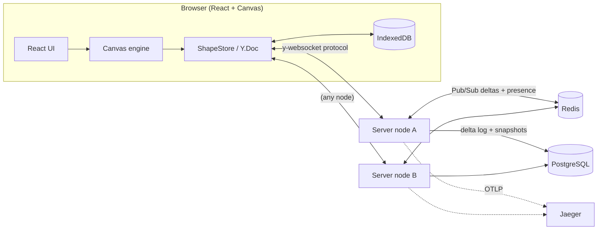

# Collaborative Canvas

A multi-tenant, **local-first**, real-time collaborative whiteboard (think a mini Figma/Miro).
Several people draw on the same infinite canvas at once, see each other's cursors and selections
live, keep working while offline, and never lose or overwrite each other's edits.

> Built as a portfolio project to demonstrate distributed state, real-time systems and
> rendering performance, not a CRUD app.

 

## Highlights

| Area                    | What it does                                                                                                                                                                                                   |
| ----------------------- | -------------------------------------------------------------------------------------------------------------------------------------------------------------------------------------------------------------- |
| **Conflict-free sync**  | Document state is a **Yjs CRDT**. Concurrent edits (even to the same note's text) merge deterministically. There's no locking and nothing is "last write wins" at document level.                              |
| **Local-first**         | Every edit applies locally first (0 ms latency), is cached in **IndexedDB by a Web Worker** (never blocks the UI), and syncs when a connection exists. Offline edits merge on reconnect.                       |
| **60+ FPS rendering**   | Custom **Canvas 2D** engine with a **cached shape layer** (pan = bitmap shift, edits = dirty-rect repaint), spatial-hash culling, LOD. 100,000 shapes: **120 fps, p95 frame 2.5 ms, delete-to-paint < 10 ms**. |
| **Presence**            | Live cursors (throttled to 20 Hz, smoothed with frame-rate-independent interpolation), remote selection highlights, who's-online list.                                                                         |
| **Horizontal scale**    | Stateful WebSocket nodes fan out deltas over a **Redis Pub/Sub backplane**; any client can connect to any node.                                                                                                |
| **Load tested**         | **1,000 concurrent users × 100,000 edits** on one Node process: ~10k edits/s, p99 30 ms across 100 boards (165 ms with all 1,000 in one board), 0 drops, exact convergence verified.                           |
| **Durability**          | Write-behind **delta log in PostgreSQL** with debounced batching and retry, plus lock-guarded **snapshot compaction**.                                                                                         |
| **Multi-tenant + RBAC** | Signed JWTs carry tenant + role. Rooms are namespaced by tenant _from the token_; viewers' writes are dropped server-side.                                                                                     |
| **Observability**       | OpenTelemetry traces (browser `traceparent` → server spans), structured JSON logs with `trace_id`, Prometheus `/metrics`, health/readiness probes.                                                             |
| **Delivery**            | npm workspaces monorepo, shared Zod contracts, Vitest + Playwright, Docker images, Compose stack (2 replicas), GitHub Actions CI/CD.                                                                           |

## Architecture



## Quick start (no Docker needed)

```bash
npm install
npm run dev          # server on :4000 (in-memory mode) + web on :5173
```

Open <http://localhost:5173> in two browser windows, join the same board with different names,
and draw. See **[docs/04-build-and-test.md](docs/04-build-and-test.md)** for the full guide,
including the two-node Redis/Postgres cluster.

## Documentation

| Doc                                                        | Read it to learn                                                        |
| ---------------------------------------------------------- | ----------------------------------------------------------------------- |
| [01 — Overview & concepts](docs/01-overview.md)            | What the product does and the core ideas (CRDTs, local-first, presence) |
| [02 — Tech stack](docs/02-tech-stack.md)                   | Every technology used, why, and what it replaced                        |
| [03 — Architecture](docs/03-architecture.md)               | Components, data flows, scaling, failure modes, security, decisions     |
| [04 — Build, run & test](docs/04-build-and-test.md)        | Step-by-step setup, manual test scenarios, troubleshooting              |
| [05 — SDLC](docs/05-sdlc.md)                               | Requirements, testing strategy, CI/CD, operations runbook, roadmap      |
| [06 — Scaling design](docs/06-scaling-design.md)           | Target architecture for 1B shapes and 1M edits/s, with a staged plan    |
| [07 — Development history](docs/07-development-history.md) | How it was built: decisions, alternatives, bugs, measurements, lessons  |

## Repository layout

```
collaborative-canvas/
├── packages/shared/        # Zod contracts + protocol constants shared by client & server
├── apps/server/            # Node.js WebSocket collaboration server
│   ├── src/collab/         #   domain: Room actor, RoomRegistry, compaction, ports (interfaces)
│   ├── src/infrastructure/ #   adapters: Redis backplane, Postgres store, in-memory versions
│   ├── src/http/           #   transport: WS gateway, REST routes, JWT, rate limiting
│   ├── src/observability/  #   logging, tracing, metrics
│   └── migrations/         #   SQL migrations
├── apps/web/               # React + Canvas 2D client
│   ├── src/collab/         #   Yjs session, ShapeStore, presence, text diffing
│   ├── src/canvas/         #   engine, renderer, viewport, spatial index, interpolation
│   └── src/ui/             #   React components
├── e2e/                    # Playwright multi-user tests
├── tools/load-test/        # 1,000-user WebSocket load generator + convergence verifier
├── docker-compose.yml      # Postgres, Redis, Jaeger, 2 server replicas, web
└── .github/workflows/      # CI/CD
```

## Scripts

| Command                       | Purpose                                                 |
| ----------------------------- | ------------------------------------------------------- |
| `npm run dev`                 | Single node, in-memory, hot reload                      |
| `npm run infra:up`            | Start Postgres, Redis, Jaeger in Docker                 |
| `npm run dev:cluster`         | Two server nodes + web against real infra               |
| `npm test`                    | Unit + integration tests (infra tests auto-skip w/o DB) |
| `npm run test:e2e`            | Playwright multi-user browser tests                     |
| `npm run load-test -- --help` | 1,000-user load test (see docs §8)                      |
| `npm run lint` / `typecheck`  | Static checks                                           |
| `npm run build`               | Production build of all packages                        |
| `docker compose up --build`   | Full production-like stack on :8080                     |
