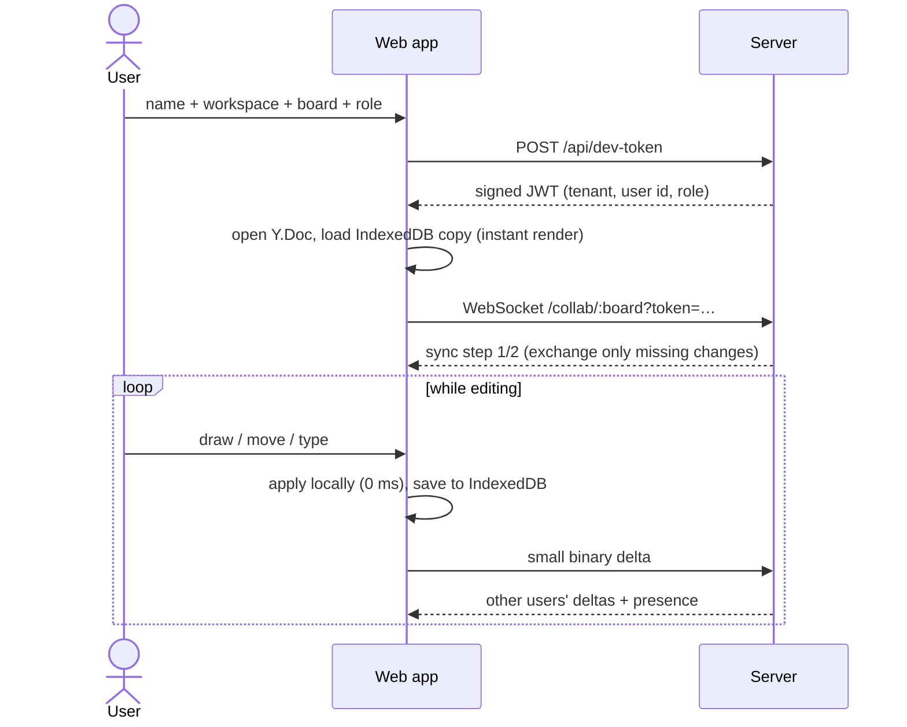

# 01 — Overview & Core Concepts

## What the product does

Collaborative Canvas is a shared whiteboard. A user picks a **workspace** (tenant), a **board**
(room) and a **role**, and lands on an infinite canvas where they can:

- draw rectangles, ellipses and sticky **notes** (with editable text),
- select (click, shift-click, marquee), move, resize, recolor, delete,
- undo/redo **their own** changes (never someone else's),
- pan (drag with Pan tool / hold Space / scroll) and zoom (Ctrl/⌘ + scroll, `+`/`-`, Fit),
- see everyone else's **cursor, name and selection** live,
- keep working **offline**. Changes are stored in the browser and merge automatically later.

Viewers can watch everything live but cannot change the board.

### User flow

## Core concepts (read these to understand the code)

### 1. CRDT (Conflict-free Replicated Data Type)

A data structure that many replicas can edit **independently** and that is guaranteed to
converge to the same state once they've seen the same set of changes, **in any order,
any number of times**. No central lock, no "your change was rejected".

We use **Yjs**. The board is one `Y.Doc` containing a `Y.Map` of shapes; each shape is its own
`Y.Map` (so Alice moving a shape and Bob recoloring it both survive), and each note's text is a
`Y.Text` (so two people typing in the same note interleave characters instead of overwriting).

Properties we rely on:

| Property      | Why it matters here                                                                        |
| ------------- | ------------------------------------------------------------------------------------------ |
| Commutative   | Updates can arrive in any order (via different server nodes, after being offline).         |
| Idempotent    | Receiving the same update twice is harmless, so overlapping snapshot + log replay is safe. |
| State vectors | A replica can say "I have up to X from each client" and receive **only** the diff.         |

### 2. Local-first

The local `Y.Doc` is the source of truth for the UI. The network is just a way to exchange
updates. Consequences:

- **Zero-latency** interaction: we never wait for a server round-trip.
- **Offline**: an IndexedDB cache, written by a Web Worker, persists the doc; reloads work without a server.
- **Optimistic by construction**: no need for rollback logic because CRDT merges can't "fail".

### 3. Presence (awareness)

Cursors, names and selections are **ephemeral**. They should never be persisted or undone.
They travel over Yjs _awareness_, a separate, last-writer-wins per-client state with a 30 s
timeout. We throttle cursor broadcasts to **20 Hz** and **interpolate** remote cursors every
frame so they glide smoothly instead of jumping.

### 4. Stateful WebSockets + backplane

Each server node keeps an in-memory `Room` (a live `Y.Doc`) per active board. When a client on
node A edits, node A:

1. applies the update and relays it to its own local clients,
2. **publishes** it on Redis channel `collab:room:<tenant>/<board>`,
3. appends it to the **delta log** in Postgres (batched).

Node B, subscribed to the same channel, applies it and relays it to _its_ clients. So clients
on different nodes collaborate as if on one server. Because Pub/Sub can drop messages, nodes also
gossip their **state vectors** every 15 s. A node that has something another lacks sends
exactly that diff (anti-entropy).

### 5. Snapshots & compaction

Appending every keystroke forever would make loading a board slow. The **write-behind buffer**
merges bursts of updates into one row (every 250 ms), and **compaction** periodically folds
"snapshot + all delta rows" into one new garbage-collected snapshot, inside a transaction
protected by a Postgres advisory lock so two nodes never compact the same board at once.

### 6. Multi-tenancy

A room's storage key is `tenant/board`, where **tenant comes from the verified JWT**, never
from the URL. Two companies using a board called `design-review` can never see each other's
data. This is covered by both integration and E2E tests.
