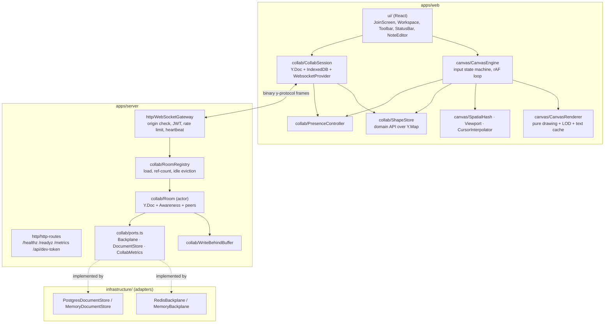
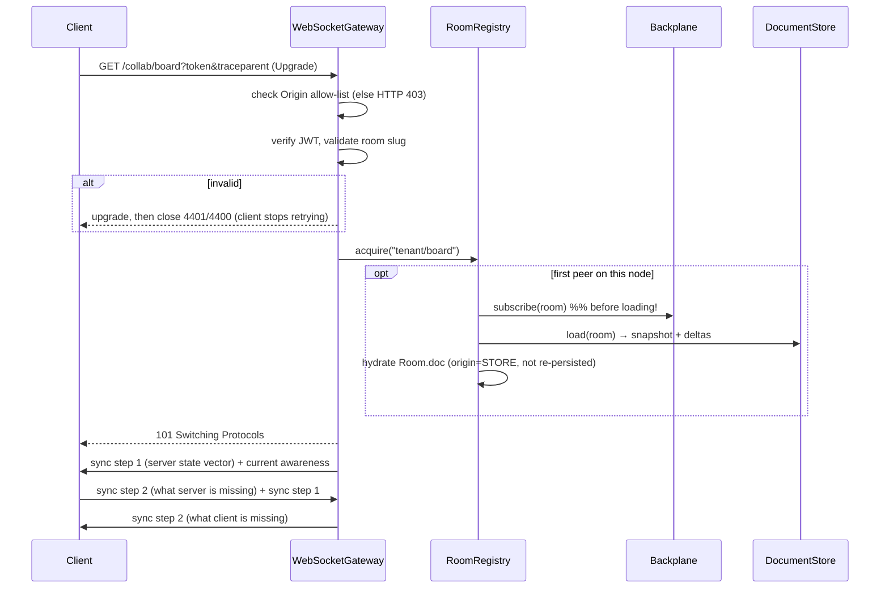
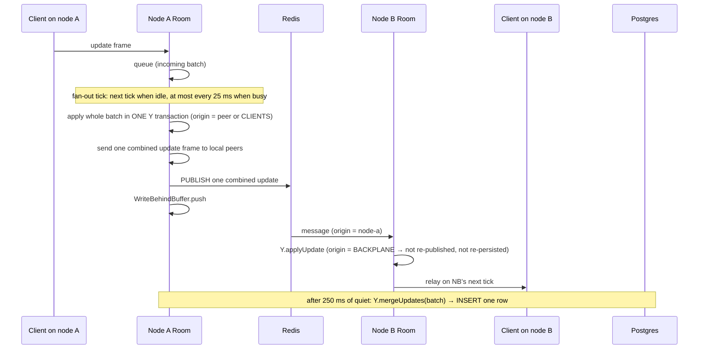

# 03 — Architecture

## 1. Component view



### Clean architecture on the server

- `collab/` is the **domain**. It depends only on interfaces in `collab/ports.ts`
  (`Backplane`, `DocumentStore`, `CollabMetrics`, `Peer`). It has no Redis, SQL or `ws` imports.
- `infrastructure/` contains **adapters** for those ports. In-memory adapters give a zero-setup
  dev mode and let integration tests simulate a multi-node cluster in one process.
- `http/` is the **transport**. `WebSocketPeer` adapts a `ws` socket to the `Peer` port.
- `app.ts` is the **composition root** (pure wiring, reused by tests); `main.ts` picks adapters
  from config and handles process lifecycle.

### Separation on the client

- `collab/` knows Yjs; nothing else does. `ShapeStore` exposes plain `Shape` objects and
  intention-revealing methods (`moveBy`, `setFill`, `setText`, …).
- `canvas/` is framework-agnostic and never touches Yjs types.
- `ui/` is thin React that binds via `useSyncExternalStore`.

### Client rendering pipeline

Each frame has three passes. Only the middle one touches shapes, and it's cached.

| Pass                                      | What                                                                  | Cost per frame                                                                                                                                                                                                                                                          |
| ----------------------------------------- | --------------------------------------------------------------------- | ----------------------------------------------------------------------------------------------------------------------------------------------------------------------------------------------------------------------------------------------------------------------- |
| Background                                | Fill + grid dots                                                      | constant, tiny                                                                                                                                                                                                                                                          |
| **Shape layer** (`canvas/shape-layer.ts`) | Double-buffered `OffscreenCanvas` of the viewport                     | **Pan:** shift pixels by whole device pixels and draw only the exposed strips. **Edit:** clear and redraw only dirty rects (old and new bounds from the spatial index). **Zoom gesture:** show the old bitmap scaled, re-render once 120 ms after the last wheel event. |
| Overlays                                  | Selection (one box beyond 500 shapes), marquee, draft, remote cursors | proportional to overlays, not board size                                                                                                                                                                                                                                |

So a frame costs **what changed**, not how many shapes are visible. Remote cursors gliding at
60 fps no longer redraw every shape.

**Offline cache off the main thread** (`collab/persistence.worker.ts`): the main thread only
posts each small update. The worker batches writes, and compacts in the background by replaying
into a fresh doc when small, or with a binary `mergeUpdates` when large, so it never holds a
second full document copy. It keeps y-indexeddb's store layout, so older caches still load.

**Board size guardrail:** a Yjs shape costs about 4 KB of heap. 600k shapes measured about 2.4 GB,
enough to crash a tab. `ShapeStore` rejects edits past **100,000 shapes per board** with a
visible message.

## 2. Key flows

### 2.1 Connect & initial sync



**Why subscribe before load?** Anything another node publishes while we're reading from
Postgres is applied too. CRDT idempotency makes the overlap harmless, and nothing is missed.

### 2.2 An edit



**Invariant:** an edit is persisted and published **exactly once**, by the node whose client
produced it. The `origin` of each Yjs transaction (`peer` / `CLIENTS` / `STORE` / `BACKPLANE`)
enforces this.

**Why batch?** Profiling a 1,000-user room showed about 50% of server CPU in per-edit Yjs
transactions and `mergeUpdates`. Applying each tick's edits in one transaction makes Yjs emit
one combined update per tick, so N edits × M peers socket writes become (ticks/s) × M. An idle
room still sends on the next event-loop tick, so it adds no latency. A malformed update rejects
only its sender (`4400`); the rest of the batch still applies.

**Open-time catch-up:** when a node opens a room it also broadcasts its state vector. Another
node that has published edits it hasn't persisted yet (write-behind window) replies with the diff
immediately, instead of waiting for the periodic anti-entropy round.

### 2.3 Compaction

Triggered after `COMPACTION_THRESHOLD` flushes and when a room is evicted:

```sql
BEGIN;
SELECT pg_try_advisory_xact_lock(hashtextextended('tenant/board', 0)); -- else skip
SELECT state FROM document_snapshots WHERE room_key = $1;
SELECT seq, update FROM document_updates WHERE room_key = $1 ORDER BY seq;
-- merge in a fresh Y.Doc (garbage-collects deleted content)
UPSERT document_snapshots ...;
DELETE FROM document_updates WHERE seq = ANY($read_seqs);  -- exactly the rows read
COMMIT;
```

Deleting **exactly the rows read** (not `seq <= max`) matters: a concurrent insert may have
allocated a lower `seq` but committed after our read. It stays and is folded in next time.

### 2.4 Room lifecycle

`acquire` (ref++) → … → `release` (ref--) → at 0, wait `ROOM_IDLE_TTL_MS` →
**flush** → if the flush failed (DB down), **postpone eviction** so edits stay in memory →
**compact** → unsubscribe → destroy.

## 3. Wire protocol

Binary frames, first varuint = message type (`packages/shared/src/protocol.ts`):

| Type | Name           | Payload                                                           |
| ---- | -------------- | ----------------------------------------------------------------- |
| 0    | Sync           | sub-type 0 = step 1 (state vector), 1 = step 2 (diff), 2 = update |
| 1    | Awareness      | presence states (JSON inside a binary envelope)                   |
| 3    | QueryAwareness | ask for all presence states                                       |

Close codes: `4400` bad request, `4401` unauthorized, `4403` forbidden (client stops retrying);
`1008` rate limit, `1009` too big, `1012` server restart, `1013` slow client / try later.

Backplane envelope (Redis): `[origin node id: varstring][kind: varuint][payload: varbytes]`, where
kind is `0` doc update, `1` awareness, `2` state vector (anti-entropy).

## 4. Scaling model

- **Horizontal:** add nodes behind any L4/L7 load balancer. No sticky sessions required. A
  board's clients may be spread across nodes.
- **Per-room cost** lives only on nodes that currently have clients for it.
- **Limits:** Redis Pub/Sub delivers every message to every subscribed node, so a single very
  hot board is bounded by one Redis instance's throughput. Next steps would be Redis Cluster
  sharded Pub/Sub, or consistent-hash routing so each board lives on one node.

## 5. Failure modes

| Failure                    | Behaviour                                                                                                                                                                                                                                 |
| -------------------------- | ----------------------------------------------------------------------------------------------------------------------------------------------------------------------------------------------------------------------------------------- |
| Client network drop        | Keeps editing locally (IndexedDB). On reconnect, state-vector sync sends only the diff.                                                                                                                                                   |
| Server node crash / deploy | `SIGTERM` → stop accepting, close sockets with `1012`, flush all rooms. Clients reconnect (to any node) with exponential backoff.                                                                                                         |
| Redis message lost         | Pub/Sub is at-most-once. **Anti-entropy:** every `ANTI_ENTROPY_INTERVAL_MS` (15 s) each node publishes its state vector per room; any node with newer data replies with exactly the missing diff. Covered by a test that drops a message. |
| Postgres down              | Writes are re-queued with exponential backoff; rooms aren't evicted while dirty; `/readyz` turns 503.                                                                                                                                     |
| Slow client                | Outbound buffer > 8 MB → closed with `1013` (protects server memory).                                                                                                                                                                     |
| Flooding client            | Token bucket (burst 400, 200 msg/s) → closed with `1008`.                                                                                                                                                                                 |
| Malformed frames           | `ProtocolError` → `4400`; other peers unaffected.                                                                                                                                                                                         |
| Dead TCP connection        | Server ping every 30 s, terminate if no pong. Client watchdog closes after 30 s silence (server echoes awareness renewals as keep-alive).                                                                                                 |

## 6. Security

| Threat (OWASP)                 | Mitigation                                                                                                                                             |
| ------------------------------ | ------------------------------------------------------------------------------------------------------------------------------------------------------ |
| Broken access control (A01)    | Tenant taken from verified JWT only; room key = `tenant/room`; viewer writes dropped server-side; tests for both.                                      |
| Cross-site WebSocket hijacking | `Origin` allow-list checked at upgrade.                                                                                                                |
| Crypto failures (A02)          | HS256 with ≥ 32-char secret, required in production; short-lived (1 h) tokens; issuer/audience/alg pinned.                                             |
| Injection (A03)                | Parameterized SQL only; slug regex on tenant/room ids; Zod on all JSON input.                                                                          |
| Insecure design / DoS (A04)    | Max frame size, JSON body limit (4 KB), rate limiting, backpressure, heartbeat.                                                                        |
| Misconfiguration (A05)         | Config validated at boot (fail fast); dev-token endpoint **off by default in production**; CSP and security headers in nginx; non-root container user. |
| Logging failures (A09)         | Structured logs; tokens redacted; query strings (which carry the token) are never logged.                                                              |
| Untrusted peer data            | Presence states and malformed shapes from other clients are validated before use.                                                                      |

**Known trade-offs (documented, not hidden):**

- Tokens are passed as a query parameter because browsers can't set headers on WebSocket
  handshakes. They're short-lived and never logged. A production system would exchange them
  for a one-time ticket.
- The dev-token endpoint is a stand-in for a real identity provider (OIDC).
- Yjs can't express fine-grained per-field permissions; RBAC here is per board (editor/viewer).

## 7. Architecture decisions (ADR summary)

| #   | Decision                                      | Alternatives                   | Rationale                                                                             |
| --- | --------------------------------------------- | ------------------------------ | ------------------------------------------------------------------------------------- |
| 1   | Yjs CRDT over OT                              | ShareDB (OT), Automerge        | No central transform server needed; offline-friendly; fastest JS CRDT.                |
| 2   | Custom server instead of `y-websocket` server | Hocuspocus, y-websocket-server | Needed tenant isolation, RBAC, backplane, write-behind, compaction, metrics.          |
| 3   | Canvas 2D over DOM/SVG                        | SVG, WebGL                     | DOM can't hold 5k+ nodes at 60 fps; WebGL is overkill for flat shapes.                |
| 4   | Redis Pub/Sub backplane                       | NATS, sticky routing           | Simple, ubiquitous; stateless LB; message loss repaired by state-vector anti-entropy. |
| 5   | Postgres delta log + snapshots                | S3 blobs, Redis streams        | Transactions + advisory locks make compaction correct under concurrency.              |
| 6   | Ports & adapters with in-memory impls         | Always require infra           | `npm run dev` works with zero setup; multi-node tests run in one process.             |
| 7   | Zod contracts package                         | OpenAPI codegen, tRPC          | Tiny REST surface; one schema gives both runtime validation and types.                |
