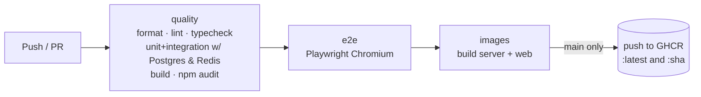

# 05 — Software Development Life Cycle

How this project moves through each SDLC phase, and where the evidence lives in the repo.

## 1. Requirements

### Functional

| ID  | Requirement                                                             | Verified by                               |
| --- | ----------------------------------------------------------------------- | ----------------------------------------- |
| F1  | Users join a board in a workspace with a display name and role          | E2E, `JoinScreen`                         |
| F2  | Create, select, move, resize, recolor, delete rectangles/ellipses/notes | Manual §3, `ShapeStore` tests             |
| F3  | Edit note text collaboratively                                          | `shape-store.test.ts` (concurrent typing) |
| F4  | Edits appear for all users of the board in real time                    | Integration + E2E                         |
| F5  | Live cursors, names and selections of other users                       | Integration (awareness), manual           |
| F6  | Undo/redo only affects the user's own edits                             | `UndoManager` with `trackedOrigins`       |
| F7  | Edits made offline are preserved and merged on reconnect                | E2E offline test                          |
| F8  | Viewers can observe but not modify                                      | Integration + E2E                         |
| F9  | Boards are isolated per workspace (tenant)                              | Integration + E2E                         |

### Non-functional

| ID  | Requirement            | Target / Result                                                                                    |
| --- | ---------------------- | -------------------------------------------------------------------------------------------------- |
| N1  | Rendering performance  | 60 fps at the 100k-shape board limit → measured 120 fps, p95 frame 2.5 ms, delete-to-paint < 10 ms |
| N2  | Local edit latency     | 0 ms (applied locally before network)                                                              |
| N3  | Horizontal scalability | Any number of stateless-routed nodes via backplane                                                 |
| N4  | Durability             | Every edit persisted (retry on failure); snapshots compacted                                       |
| N5  | Security               | OWASP mitigations (see architecture §6)                                                            |
| N6  | Observability          | Traces, structured logs, metrics, health probes                                                    |
| N7  | Operability            | Graceful shutdown, config validated at boot                                                        |

## 2. Design

- Architecture, flows and trade-offs: [03-architecture.md](03-architecture.md)
- Decisions recorded as an ADR table (architecture §7)
- Contracts first: `packages/shared` defines schemas before either side implements them.

## 3. Implementation standards

- **Strict TypeScript** everywhere (`strict`, `noUncheckedIndexedAccess`, no `any` in app code).
- **Ports & adapters** on the server; framework-agnostic engine on the client.
- **Small, single-purpose modules** (e.g. `Viewport`, `SpatialHash`, `WriteBehindBuffer`), each unit-tested.
- **Validation at boundaries only**: env (Zod), HTTP bodies (Zod), socket frames (protocol decoder),
  peer-supplied presence/shapes (type guards). Internals trust their types.
- **Formatting & linting** enforced by Prettier + ESLint (type-aware imports, React hooks rules).

## 4. Testing strategy (test pyramid)

```
          ▲  E2E (Playwright, 4)          real browsers, real servers
         ▲▲▲ Integration (Vitest, ~13)    real WS servers, 2-node cluster in-process, real PG/Redis in CI
      ▲▲▲▲▲▲ Unit (Vitest, ~45)           pure logic: CRDT store, compaction, geometry, auth, buffers
```

- Tests use **real collaborators** where cheap (real Yjs, real sockets) and fakes only at
  infrastructure edges (in-memory adapters implementing the same ports).
- Timing-sensitive logic uses **fake timers** or explicit gates; no sleeps as synchronization.
- Infra-dependent tests **auto-skip** locally without Docker and **always run in CI**
  (service containers).

## 5. CI/CD pipeline (`.github/workflows/ci.yml`)



- Concurrency group cancels superseded runs.
- Least-privilege `permissions` per job.
- Dependabot keeps npm, Actions and base images current.

> **Monorepo note:** GitHub reads workflows only from the repository root. If this folder is
> pushed as its own repo (recommended for a portfolio), it works as-is. If it lives inside a
> larger repo, move `.github/` to the root and add `defaults: run: working-directory: collaborative-canvas`
> plus `paths: ['collaborative-canvas/**']` filters.

## 6. Deployment

Artifacts: `ghcr.io/<owner>/collab-canvas-server` and `collab-canvas-web` (nginx static).

Free-tier-friendly targets:

| Component | Free option                                                                       |
| --------- | --------------------------------------------------------------------------------- |
| Web       | Any static host (Cloudflare Pages, Netlify, GitHub Pages) or the nginx image      |
| Server    | Any container host with WebSocket support (e.g. Fly.io, Render, Koyeb free tiers) |
| Postgres  | Neon / Supabase free tier                                                         |
| Redis     | Upstash free tier (Pub/Sub over TLS: use `rediss://`)                             |

Production checklist:

- [ ] `NODE_ENV=production`, strong `JWT_SECRET` from the platform's secret store
- [ ] `AUTH_DEV_TOKENS=false` once a real IdP issues tokens
- [ ] `ALLOWED_ORIGINS` = your web origin only
- [ ] TLS everywhere (`wss://`, `https://`)
- [ ] Web built with `VITE_COLLAB_SERVERS=https://your-api` and matching `CSP_CONNECT_SRC`
- [ ] Liveness → `/healthz`, readiness → `/readyz`, scrape `/metrics`
- [ ] Rolling deploys with ≥ 10 s termination grace (graceful shutdown drains rooms)

## 7. Operations runbook

| Signal                                              | Likely cause               | Action                                                                                                            |
| --------------------------------------------------- | -------------------------- | ----------------------------------------------------------------------------------------------------------------- |
| `/readyz` 503, `checks.store=false`                 | Postgres unreachable       | Edits are buffered in memory with retry; restore DB; watch `collab_persist_duration_seconds{result="error"}` drop |
| `/readyz` 503, `checks.backplane=false`             | Redis unreachable          | Cross-node sync paused; same-node users unaffected; restore Redis                                                 |
| Rising `collab_compactions_total{result="skipped"}` | Lock contention            | Normal under multi-node load; investigate only if `document_updates` keeps growing                                |
| Many `1013` closes in logs                          | Slow clients / huge boards | Check client networks; consider raising buffer limit                                                              |
| Many `1008` closes                                  | Buggy or abusive client    | Identify `user_id` in logs; revoke/rotate                                                                         |
| Log line `shutting down with unpersisted changes`   | DB down during deploy      | Those clients still hold the edits and will re-sync them on reconnect                                             |

## 8. Maintenance & roadmap

The long-term scaling path (1B shapes per board, 1M edits/s) is designed in
[06-scaling-design.md](06-scaling-design.md), with stage gates. Near-term items:

- Replace dev tokens with OIDC (e.g. Keycloak, free) and short-lived WebSocket tickets.
- Store snapshots in S3-compatible storage (MinIO locally) via a new `DocumentStore` adapter.
- Document history / time-travel using retained snapshots.
- Consistent-hash routing so a hot board lives on one node (removes Pub/Sub fan-out limit).
- WebGL renderer behind the same `FrameModel` interface for 100k+ objects.
- Run the load test against the Redis + Postgres cluster with clients on separate machines.
- Presence culling (only broadcast cursors near a viewer's viewport) for 1,000-person rooms.
