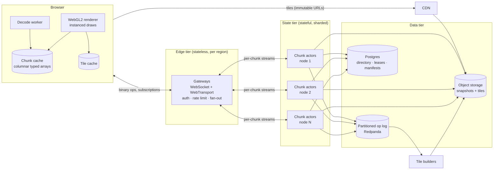
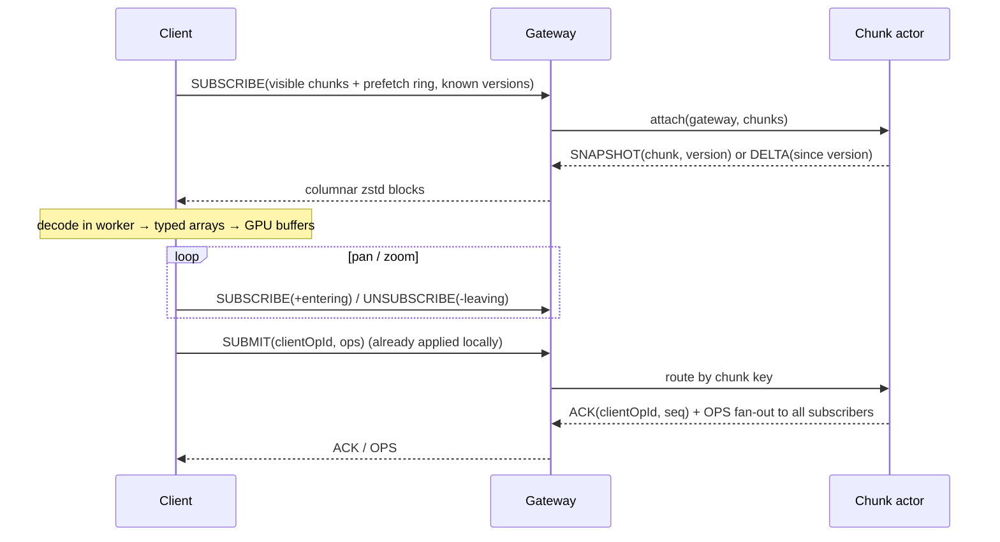

# 06 — Scaling Design: 1 Billion Shapes, 1 Million Edits/s

This is the target architecture for taking Collaborative Canvas from **100k shapes per board**
and **~10k edits/s per process** to **1,000,000,000 shapes per board** and **1,000,000
edits/s**, with smaller storage and the lowest achievable latency.

It is a **design**, not shipped code. Every number is labelled:

- **Measured**: produced by this repository's benchmarks or load tests.
- **Estimate**: derived from measurements or arithmetic; must be confirmed at the stage gate
  listed in §14 before building on it.
- **Target**: the SLO the design commits to.

---

## 1. Goals and non-goals

| Goal                         | Target                                                        |
| ---------------------------- | ------------------------------------------------------------- |
| Shapes per board             | 1,000,000,000                                                 |
| Aggregate edit throughput    | 1,000,000 edits/s per regional cluster, horizontally scalable |
| Edit → collaborator's screen | p50 ≤ 25 ms, p99 ≤ 100 ms (same region)                       |
| Edit → own screen            | 0 ms (optimistic, local-first, as today)                      |
| Storage at rest              | ≤ 8 bytes per shape (compressed snapshot)                     |
| Client memory                | ≤ 300 MB **regardless of board size**                         |
| Frame rate                   | 60 fps at every zoom level                                    |
| Durability                   | An acknowledged edit survives any single-node failure         |

**Non-goals**

- Showing every one of a billion shapes as a live, individually editable object at the same
  time. At full zoom-out a 4K screen has ~8M pixels, so most shapes are sub-pixel. They are
  shown as pre-drawn tiles (§7), like a map.
- Beating the speed of light. Cross-continent collaboration stays at 40–80 ms network latency.
- Merging concurrent edits to the _same field of the same shape_ (e.g. two people dragging one
  rectangle at the same instant). The last write wins there, as in Figma. Text keeps
  character-level merging.

## 2. Why the current architecture stops at ~100k

| Constraint                         | Evidence (measured)                                                                 | Consequence at 1B shapes                         |
| ---------------------------------- | ----------------------------------------------------------------------------------- | ------------------------------------------------ |
| Every client holds the whole board | 3,672 B heap per shape (Yjs nested `Y.Map`); 600k shapes = 2.4 GB, tab crashed      | 3.7 TB per client (impossible)                   |
| Storage format                     | 202 B/shape raw, 68 B gzipped                                                       | 68 GB compressed per board                       |
| One room = one process             | ~10k edits/s with one board on one process; p99 165 ms with 1,000 users in one room | 100× short of target                             |
| Fan-out is board-wide              | 9.17 GB delivered for 100k edits in one 1,000-user board                            | Every edit reaches every user even if off-screen |
| Full-state operations              | Encoding a 600k-shape doc: 2.6 s, 128 MB                                            | Snapshots/joins become multi-minute              |

The fix is not a faster version of the same thing. It changes three assumptions:

1. **Nobody loads the whole board**: clients subscribe to what's on screen (interest management).
2. **A board is not one document**: it is millions of small, independently owned **chunks**.
3. **Geometry doesn't need a sequence CRDT**: per-field last-writer-wins registers in columnar
   arrays use ~260× less memory (measured) and converge just as deterministically for this
   data. Keep the CRDT only for text.

## 3. Architecture overview



| Tier          | Owns                                       | Scales with                | Failure impact                             |
| ------------- | ------------------------------------------ | -------------------------- | ------------------------------------------ |
| Edge          | Sockets, auth, per-connection fan-out      | Concurrent connections     | Clients reconnect to another gateway       |
| State         | Authoritative in-memory chunks, sequencing | Edits/s on _active_ chunks | Chunks re-hosted from snapshot + log       |
| Data          | Durable log, snapshots, tiles, directory   | Bytes stored / written     | Replicated (managed or 3-node)             |
| Tile builders | Zoomed-out imagery                         | Change rate                | Tiles go stale; live overlay still correct |

This separates **connection count** (edge) from **edit throughput** (state). Today both
live in one process.

## 4. Data model

### 4.1 Coordinates, ids and ordering

| Field    | Encoding                                                          | Why                                                                       |
| -------- | ----------------------------------------------------------------- | ------------------------------------------------------------------------- |
| Position | `int32` in 1/16-px units                                          | ±134M px range at sub-pixel precision; deltas compress well               |
| Size     | `uint32` in 1/16-px units                                         |                                                                           |
| Id       | `uint64` = `sessionId:u32 · counter:u32`                          | 8 B instead of a 36-char UUID; allocated client-side without coordination |
| Z-order  | Fractional index (base-62 string, typically 2–5 B)                | Reorder one shape without renumbering others                              |
| Fill     | `uint8` palette index + optional custom RGBA table                | Most boards use < 256 colours                                             |
| Kind     | `uint8`                                                           |                                                                           |
| Text     | Reference to a text sub-document (Yjs `Y.Text`), loaded on demand | Only notes pay CRDT cost, and only while open                             |

### 4.2 Conflict resolution

Each shape is a set of **LWW registers**, grouped as `geometry` (x, y, w, h), `style`
(fill, kind) and `order` (z). Each register carries a **Hybrid Logical Clock** timestamp
`(physical ms, logical counter, sessionId)`.

- Two users moving the same shape: the later HLC wins, identically on every replica.
- One user moves while another recolours: both apply, because they're different registers.
- Delete wins over concurrent updates. It leaves a tombstone, which is garbage-collected once
  the chunk's **stability watermark** (min HLC acknowledged by all subscribers) passes it.
- Text: a Yjs sub-document per note preserves today's character-level merging.

Measured per-shape cost of the new layout, compared with today:

| Representation                   | Heap / shape | Stored / shape | Gzipped / shape |
| -------------------------------- | ------------ | -------------- | --------------- |
| Today: nested `Y.Map` + `Y.Text` | 3,672 B      | 202 B          | 68.4 B          |
| Flat record in `Y.Map` (stage 1) | 430 B        | 31 B           | 10.5 B          |
| Columnar typed arrays (stage 2+) | 14 B         | 14 B           | 5.4 B           |

_All measured with 100k shapes (`node --expose-gc`, Yjs 13.6)._

### 4.3 Operation encoding (wire and log)

```
SetFields  [shapeId u64][chunk u64][hlc u64][fieldMask u8][values…]   ≈ 30 B for a move
Create     [shapeId u64][chunk u64][hlc u64][full record]            ≈ 45 B
Delete     [shapeId u64][chunk u64][hlc u64]                          = 24 B
Batch      [count varint][op…], zstd-compressed with a per-board dictionary above 1 KB
```

Continuous drags are **coalesced per tick**: the client sends one `SetFields` per shape per
frame (latest position), not every pointer event.

## 5. Spatial partitioning

### 5.1 Loose quadtree of chunks

- Level 0 chunk = 4,096 × 4,096 px of world space. Each level up covers 4× the area.
- A shape lives in the **smallest cell whose "loose" bounds (2× the cell) contain it**. Small
  shapes live in leaf chunks; huge shapes live higher up. This avoids duplicating shapes across
  chunk borders.
- Chunk key = `(boardId, level, cx, cy)` packed into a `uint64` (Morton / Z-order curve, so
  nearby chunks have nearby keys and range scans stay cheap).
- **Adaptive split**: a chunk splits into 4 children at > 50,000 shapes or > 5,000 edits/s
  sustained, and merges back when cold. Hot spots don't need a global re-partition.

### 5.2 Moving a shape across chunks

`Move(shape, from, to)` is a two-step, idempotent handoff with a single operation id:

1. The source actor writes a **forwarding tombstone** `{shape → to, hlc}` and sends `Adopt` to
   the destination actor.
2. The destination inserts the shape (same id, same HLC) and acknowledges.
3. On retry or duplicate delivery, `Adopt` is ignored if the destination already holds the
   shape with an HLC ≥ the op's HLC. Readers that hit the tombstone follow the pointer.

Both actors are usually on the same node (Morton-adjacent keys hash to the same shard; §8.2),
making the handoff an in-process call.

### 5.3 Chunk directory

Postgres table `chunks(board, key, level, version, shape_count, bbox, owner, lease_until,
snapshot_uri)`, cached by gateways. Only chunks that contain shapes have rows. A billion
shapes at ~20k per chunk is about 50k rows per board.

## 6. Client: interest management and rendering



- **Budget-driven detail**: the client keeps ≤ ~200k live shapes (≈ 3 MB as columnar arrays).
  When a viewport would exceed the budget it switches to **tiles** for that area (§7) and keeps
  live chunks only where zoomed in.
- **WebGL2 instanced rendering**: one draw call per chunk per shape kind, with per-instance
  attributes streamed from the typed arrays. The fractional z-index maps to a depth value, so
  opaque shapes need **no CPU sort**. **Estimate:** 1M instanced quads per frame at 60 fps on a
  mid-range laptop GPU; validate at stage 3.
- **Decode and GPU-buffer building happen in a worker**, keeping the main thread free, as
  today's IndexedDB worker already does.
- **Offline**: the chunk cache is mirrored in IndexedDB (per chunk, LRU-evicted). Offline edits
  are queued ops with HLCs and replay on reconnect. LWW makes that replay idempotent.

## 7. Level-of-detail tile pyramid

| Level       | Content                                                                | Built by                      |
| ----------- | ---------------------------------------------------------------------- | ----------------------------- |
| Live        | Individual shapes from subscribed chunks                               | Client                        |
| Tiles z1…zN | 512×512 WebP (or vector clusters when sparse), each covering 4ⁿ chunks | Tile builders from the op log |

- Tile builders consume the op log, mark dirty tiles, and re-render them **debounced** (e.g.
  every 2 s per tile). Output is written under **content-addressed URLs** (immutable, CDN-cacheable
  forever). A per-board **manifest** maps tile → current hash.
- **Freshness gap**: a zoomed-out viewer also subscribes to a lightweight **change feed** for the
  visible area. Recently changed shapes are drawn _on top of_ the (up to ~2 s stale) tile, so
  edits appear immediately even at full zoom-out.
- **Estimate:** at 1B shapes ≈ 50k leaf chunks, levels above them add ≈ 50k/4 + 50k/16 + … ≈ 17k
  tiles of ~30–80 KB each ≈ 0.5–1.4 GB per board.

## 8. Server: throughput to 1M edits/s

### 8.1 Chunk actors

- One logical actor per active chunk: an in-memory columnar chunk, a sequence number, and a
  subscriber set (gateways, not individual clients). Many actors per core, each
  single-threaded (no locks).
- Per tick (≤ 8 ms, adaptive as today's `Throttle`): apply queued ops, append the batch to the
  log, ack submitters, and send **one** batch per subscribed gateway. That is today's proven
  ingest + fan-out batching, per chunk instead of per board.

### 8.2 Placement and failover

- **Placement**: rendezvous hashing on `chunkKey >> 8`, so a Morton-neighbourhood of 256 chunks
  lands on one node. Cross-chunk moves stay local and a viewport mostly hits few nodes.
- **Leases** in Postgres (`lease_until`, renewed every 2 s). On node loss, a new owner takes the
  lease, loads the latest snapshot and replays the log from the snapshot's offset.
  **Estimate:** chunk recovery < 1 s for a 50k-shape chunk (≈ 700 KB snapshot + log tail).
- **Rebalancing**: drain by lease handoff, the same path as failover, but planned and
  zero-loss.

### 8.3 Capacity math for 1,000,000 edits/s

| Quantity                  | Value                  | Basis                                                                           |
| ------------------------- | ---------------------- | ------------------------------------------------------------------------------- |
| Apply throughput per core | 10k edits/s today      | **Measured** (Yjs, one Node process)                                            |
|                           | 50–100k edits/s        | **Estimate** for LWW columnar apply in Node (no CRDT metadata); gate at stage 2 |
| Cores for apply           | 10–20                  | 1M ÷ 50–100k                                                                    |
| Deliveries                | ≈ 4M ops/s             | **Estimate:** avg 4 viewers per active chunk (interest management)              |
| Gateway frames            | ≈ 125 per client per s | One batched frame per tick (8 ms)                                               |
| Log ingress               | ≈ 30 MB/s              | 1M × ~30 B; a few partitions suffice                                            |
| Log partitions            | 64                     | Headroom and parallel consumers (tile builders)                                 |

Gateways and actors scale independently: add gateways for connections and actors for hot edit
regions.

## 9. Storage

| Layer                  | Format                                                      | Size at 1B shapes                           |
| ---------------------- | ----------------------------------------------------------- | ------------------------------------------- |
| Chunk snapshots        | Columnar, delta-encoded coordinates, zstd                   | ≈ 5.4 GB (**measured** 5.4 B/shape gzipped) |
| Op log (hot)           | Redpanda, compacted into snapshots every N ops or T seconds | Bounded by retention (e.g. 24 h)            |
| Op log (cold, history) | Tiered to object storage, Parquet by board/day              | Optional; enables time-travel               |
| Tiles                  | WebP, content-addressed                                     | ≈ 0.5–1.4 GB (**estimate**)                 |
| Text sub-documents     | Yjs updates, compacted (today's pipeline)                   | Proportional to text written                |
| Directory / metadata   | Postgres                                                    | ≈ 50k rows per board                        |

Optimizations, in order of payoff:

1. **Drop per-field CRDT metadata** for geometry (§4.2): 202 → 14 B/shape raw.
2. **Columnar + delta + zstd**: 14 → 5.4 B/shape.
3. **Tombstone GC** past the stability watermark. Deleted shapes cost nothing after
   acknowledgement.
4. **Snapshot-then-truncate** the log per chunk (today's compaction, per chunk).
5. **Copy-on-write snapshot chains** for history: unchanged chunks are shared between versions.

## 10. Latency

| Hop                        | Today (measured)                                            | Target                                   | How                                                                                    |
| -------------------------- | ----------------------------------------------------------- | ---------------------------------------- | -------------------------------------------------------------------------------------- |
| Own screen                 | 0 ms                                                        | 0 ms                                     | Optimistic local apply (unchanged)                                                     |
| Batching window            | ≤ 25 ms                                                     | ≤ 8 ms                                   | Tick = one frame; flush immediately when idle (already)                                |
| Server apply + log append  | p99 up to 117 ms event-loop lag in a 1,000-user board       | p99 ≤ 5 ms                               | Per-chunk actors spread load; log `acks=leader`                                        |
| Network (same region)      | 5–20 ms                                                     | 5–20 ms                                  | Regional gateways, anycast DNS                                                         |
| Cursors                    | Full presence state over TCP                                | 10-byte datagrams                        | WebTransport datagrams (unreliable, latest-wins), culled to viewers of the same chunks |
| **Collaborator sees edit** | p50 14.6 / p99 30 ms (100 boards); p99 165 ms (1 hot board) | **p50 ≤ 25, p99 ≤ 100 ms** at 1M edits/s | All of the above                                                                       |

Actor placement follows the editors: a chunk's lease migrates to the region where most of its
recent writers are.

## 11. Consistency and correctness invariants

1. **Per-chunk total order**: the owning actor assigns `seq`; every subscriber applies ops in
   `seq` order. Gaps trigger a delta re-fetch.
2. **Convergence**: LWW with HLC total order plus deterministic tie-break (`sessionId`) means
   any two replicas that applied the same set of ops hold identical state, regardless of order.
3. **Durability before ack**: `ACK` is sent only after the log append succeeds.
4. **Idempotence**: every op carries `(sessionId, counter)`, so re-submission after reconnect is a no-op.
5. **Cross-chunk**: a shape is in exactly one chunk, or in transit behind a forwarding tombstone
   that resolves it.

These are verified by extending today's load-test verifier (exact final-state comparison
between editors, observers and late joiners) with chunk-moving bots and kill-a-node chaos runs.

## 12. Multi-tenancy, security and quotas

- Per-tenant quotas: shapes per board, ops/s per session and per board, storage bytes.
- Chunk-level authorization is checked at the gateway using token claims (board, role). Actors
  trust only gateways (mTLS).
- Tiles served via **signed, expiring URLs** so the CDN can't be used to read other tenants' boards.
- Abuse protection: per-connection token buckets (as today), per-board circuit breakers, and
  chunk split limits.

## 13. Observability and SLOs

| SLI                                      | SLO      |
| ---------------------------------------- | -------- |
| Edit → ack (p99)                         | ≤ 50 ms  |
| Edit → collaborator (p99, same region)   | ≤ 100 ms |
| Chunk subscribe → first paint (p95)      | ≤ 150 ms |
| Tile freshness lag (p95)                 | ≤ 5 s    |
| Actor queue depth / event-loop lag (p99) | ≤ 10 ms  |
| Acked-edit loss                          | 0        |

A trace spans browser → gateway → actor → log → tile builder with one trace id, extending
today's `traceparent` propagation.

## 14. Delivery plan (each stage ships independently)

| Stage                    | Scope                                                                                                          | Exit criteria (gate)                                                                                                                             |
| ------------------------ | -------------------------------------------------------------------------------------------------------------- | ------------------------------------------------------------------------------------------------------------------------------------------------ |
| **1. Compact model**     | Flat per-shape records, u64 ids, palette, HLC LWW for geometry; text as sub-docs; schema v2 plus migration job | 800k shapes in a tab < 600 MB heap (≈ 430 B/shape measured + render cache); all current tests plus load test green; v1 boards migrate losslessly |
| **2. Chunking**          | Loose quadtree, chunk actors in one process, SUBSCRIBE/UNSUBSCRIBE, columnar snapshots in MinIO                | 10M-shape board: client ≤ 300 MB, subscribe-to-paint p95 ≤ 150 ms; **confirm the 50–100k edits/s/core estimate**                                 |
| **3. Rendering + tiles** | WebGL2 instanced renderer, tile builders, manifest, change-feed overlay                                        | 100M shapes at 60 fps at every zoom; tile freshness p95 ≤ 5 s                                                                                    |
| **4. Distribution**      | Edge/state split, leases, rendezvous placement, Redpanda log, failover                                         | 1M edits/s across N nodes (load generator on separate machines); kill-a-node with 0 acked loss                                                   |
| **5. Latency**           | 8 ms ticks, WebTransport datagram cursors, regional gateways, lease migration toward writers                   | p50 ≤ 25 / p99 ≤ 100 ms at 1M edits/s                                                                                                            |

A billion shapes follows from stages 2 and 3 once the per-chunk and per-tile numbers hold at
100M; the architecture has no component whose cost grows with total board size.

## 15. Free, local implementation stack

| Need                  | Free option                                                                |
| --------------------- | -------------------------------------------------------------------------- |
| Object storage        | MinIO (S3 API); Cloudflare R2 free tier in the cloud                       |
| Partitioned log       | Redpanda (single-node dev mode)                                            |
| Directory and leases  | PostgreSQL (already used)                                                  |
| HTTP/3 + WebTransport | Node WebTransport server (e.g. `@fails-components/webtransport`)           |
| CDN                   | Cloudflare free plan                                                       |
| Load generation       | `tools/load-test` extended with viewport-moving bots, run from 2+ machines |

## 16. Decisions and trade-offs

| Decision                                  | Alternatives                         | Why                                                                                                        | Cost accepted                                |
| ----------------------------------------- | ------------------------------------ | ---------------------------------------------------------------------------------------------------------- | -------------------------------------------- |
| LWW registers + HLC for geometry          | Keep Yjs for everything              | ~260× less memory, ~14× less raw and ~13× less compressed storage (measured); simple, deterministic merges | Same-field concurrent edits: last write wins |
| Server-authoritative per-chunk sequencing | Pure peer-to-peer CRDT               | Enables acks, quotas, tiles and gap detection                                                              | Needs actor failover (leases)                |
| Loose quadtree                            | Uniform grid; geohash                | Big shapes don't duplicate; adaptive splits for hot spots                                                  | More complex keying                          |
| Tiles for zoomed-out views                | Stream all shapes at every zoom      | Only way to show 1B shapes at 60 fps                                                                       | Up to ~2 s staleness, masked by live overlay |
| Redpanda op log                           | Redis Pub/Sub (today), Postgres only | Durable, partitioned, replayable (failover, tiles, history)                                                | One more system to operate                   |
| WebGL2 instancing                         | Canvas 2D (today)                    | GPU draws millions of instances; no CPU z-sort                                                             | Text rendering needs an SDF/atlas path       |
| Edge/state split                          | Monolithic node (today)              | Scale connections and edit throughput independently                                                        | Extra network hop (~0.5–1 ms in-region)      |
