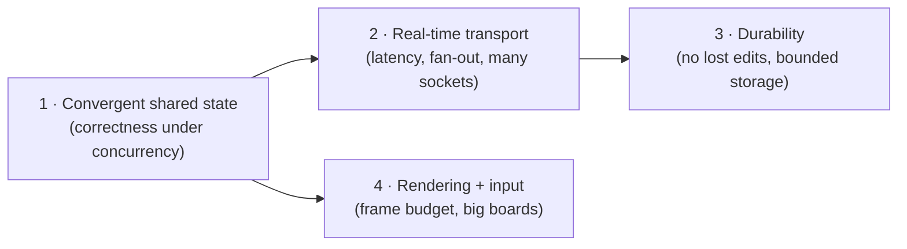
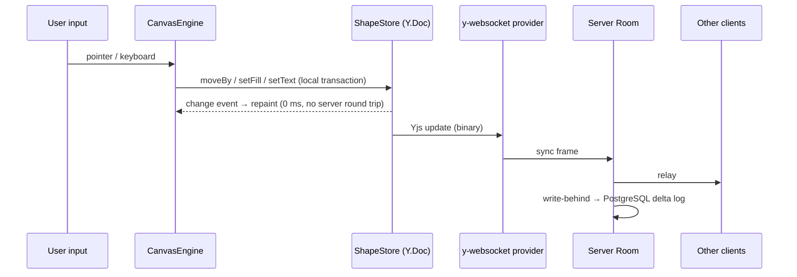
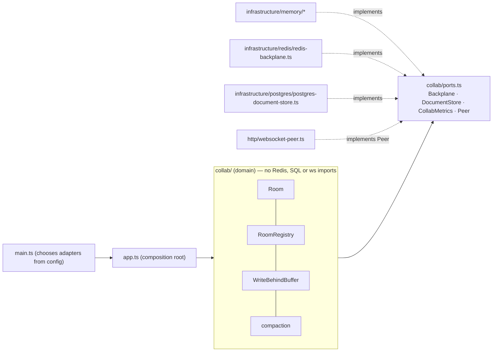
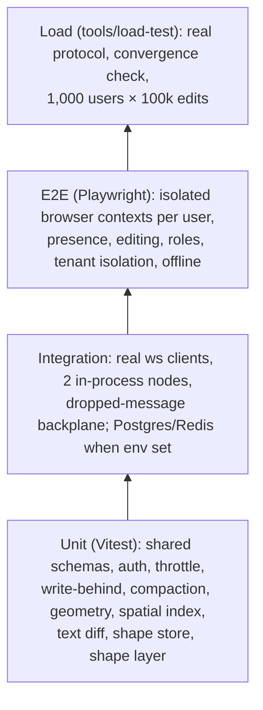
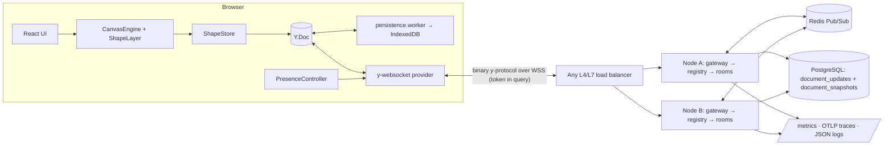

# 07: Development history and engineering retrospective

This is a technical case study of how Collaborative Canvas was designed, built, measured,
reworked and finished. The other docs describe the finished system. This one explains how the
system got that shape, which alternatives existed, what went wrong, and what carries over to
other projects.

---

## 0. Evidence and how to read this document

**There is no git history.** The project folder is not a git repository, so there are no
commits, dates or diffs to reconstruct from. This document uses three kinds of evidence and
labels them.

| Label                | Source                                                                                                                                                                                            | Reliability                                                                                                 |
| -------------------- | ------------------------------------------------------------------------------------------------------------------------------------------------------------------------------------------------- | ----------------------------------------------------------------------------------------------------------- |
| **[Code]**           | Files in this repository: source, configs, tests, `tools/load-test/results/*.json`, docs `01`–`06`                                                                                                | Verifiable by anyone with the repo                                                                          |
| **[Session]**        | The recorded AI-assisted development session in which the project was built with its owner. It contains requests, commands, test output and measurements. It is **not** stored in the repository. | Faithful for order and measurements; some raw tool output was not retained, which is noted where it matters |
| **[Interpretation]** | Present-day engineering reasoning where no record of the motive exists                                                                                                                            | An explanation, **not** a historical claim                                                                  |

Wherever this document says _why_ something was done without one of the first two labels, read it
as **[Interpretation]**. The timeline in §16 is an **order** of events, not dated history.

---

## 1. Project origin and initial requirements

### 1.1 The problem

The project began from a brief by the owner **[Session]** listing four portfolio projects meant to
show "distributed state, high-concurrency data streams, edge performance, and resilient data
processing — rather than standard CRUD dashboards". Concept 1 was:

> **Collaborative Real-Time Canvas / Document Engine.** A multi-tenant, real-time collaboration
> workspace (like Figma or Notion) featuring conflict-free replicated data and canvas rendering.

The brief listed concrete expectations **[Session]**:

| Area         | Brief asked for                                                                                           |
| ------------ | --------------------------------------------------------------------------------------------------------- |
| Rendering    | Canvas, WebGL or SVG virtualization, "60 FPS under thousands of active objects"                           |
| State        | Local-first state with **Yjs or Automerge**: zero-latency typing, offline edits, automatic reconciliation |
| Presence     | Multi-user cursors, selection highlights, presence with client-side interpolation and throttled updates   |
| Backend      | Stateful WebSockets (Node.js, Go or Elixir actors) grouped by workspace rooms                             |
| Distribution | **Redis Pub/Sub or NATS** backplane across horizontally scaled nodes                                      |
| Durability   | Periodic compaction of delta logs into snapshots in **S3/PostgreSQL**                                     |

### 1.2 Constraints set by the owner

**[Session]**, in the owner's words where quoted:

1. One parent folder per project; **"after each project stop, i will check it"**.
2. **"follow clean code principles and good architectures"**.
3. **"for now do with all free resources. cover all the parts of sdlc"**.
4. Tools may be installed if they are **"free and secure to use"**.
5. Docs covering what it does, the tech stack ("only those needed"), and a step-by-step build and test guide.

### 1.3 The machine and what it implied

At project start the machine had **Node 20.19 and npm 10, with no Docker and no Go** **[Session]**.
This one fact shaped the architecture more than any other. Redis and PostgreSQL were required by
the brief, but they could not run locally at that moment. So the backend had to:

- run with **zero infrastructure** for development and most tests, and
- use Redis and PostgreSQL **when present**, without changing domain code.

That is the origin of the ports-and-adapters layout, with in-memory adapters (§6, decision D2).

### 1.4 Initial assumptions

- One board is one CRDT document. A tenant has many boards. The tenant/board pair is the unit of
  isolation (`tenant/room` keys) **[Code: `packages/shared/src/ids.ts`]**.
- Authentication could be a stand-in (a dev-token endpoint issuing JWTs) because the point of the
  project is sync and scale, not identity **[Code: `apps/server/src/http/token-service.ts`; docs/03 §6]**.
- "Thousands of objects" was the initial scale target from the brief. Load testing later raised it
  to 100,000 shapes per board and 1,000 concurrent users (§5, §7).

### 1.5 Initial scope

In scope: shapes (rectangle, ellipse, sticky note with text), move/resize/delete, multi-select,
undo/redo, presence, offline editing, viewer/editor roles, multi-node servers, persistence with
compaction, observability, tests, Docker, CI, docs. Out of scope from the start: a real identity
provider, per-field permissions, images and files, and WebGL.

---

## 2. Initial technical planning

### 2.1 How the problem was broken down

The problem splits into four sub-problems with very different characteristics:

- **State** is solved by choosing a CRDT. Everything else must _preserve_ its guarantees, not
  re-implement them.
- **Transport** is a stateful per-room actor on each node, with a backplane between nodes.
- **Durability** is a write-behind delta log plus periodic compaction into snapshots.
- **Rendering** is a custom Canvas 2D engine that never touches CRDT types directly.

### 2.2 Components identified up front

| Package           | Role                                                               | Why a separate package                                                    |
| ----------------- | ------------------------------------------------------------------ | ------------------------------------------------------------------------- |
| `packages/shared` | Zod schemas, types, wire-protocol constants, close codes, id rules | The client and server must agree byte-for-byte on protocol and validation |
| `apps/server`     | WebSocket gateway, rooms, backplane, persistence, HTTP routes      | Stateful, horizontally scaled                                             |
| `apps/web`        | React UI, canvas engine, collaboration session                     | The local-first client                                                    |
| `tools/load-test` | Real-protocol load generator (added later, §5.7)                   | Must never ship with the app                                              |
| `e2e/`            | Playwright multi-browser tests                                     | Crosses both apps                                                         |

### 2.3 Initial data and control flow

The key property is that **the local edit is visible before any network I/O**. The server is a
relay and a durability layer, not an authority that must approve edits. That follows directly
from the CRDT choice.

### 2.4 Decisions that had to be made before coding

1. The CRDT library (Yjs vs Automerge), since it fixes the wire format and the persistence format.
2. Using the stock `y-websocket` server or writing a custom one, since that fixes where tenancy,
   RBAC and persistence can live.
3. The rendering technology, since it fixes the performance ceiling.
4. The persistence model (snapshots only vs delta log plus snapshots).
5. How to develop and test without Docker (see §1.3).

---

## 3. Technology and architecture selection

Rows marked **[Code]** are visible in `package.json` files and docs/03's ADR table. The "why not"
column is partly **[Interpretation]** where docs/03 gives only a one-line reason.

| Area                 | Chosen                                            | Realistic alternatives                           | Why the choice fits _this_ project                                                                                                                                                                                                | Cost accepted                                                                                                  |
| -------------------- | ------------------------------------------------- | ------------------------------------------------ | --------------------------------------------------------------------------------------------------------------------------------------------------------------------------------------------------------------------------------- | -------------------------------------------------------------------------------------------------------------- |
| Shared state         | **Yjs 13**                                        | Automerge; ShareDB (OT); custom last-writer-wins | Brief named Yjs/Automerge. Yjs has compact binary updates, a mature sync protocol (`y-protocols`), awareness for presence, `Y.Text` for character-level merges. OT needs a central transform server, which defeats offline-first. | Yjs per-object memory cost (about 3.7 KB/shape measured, §7.4) became the eventual scale ceiling               |
| Collaboration server | **Custom Node server** on `ws` + `y-protocols`    | Hocuspocus; stock `y-websocket` server           | docs/03 ADR 2: tenant isolation, RBAC, backplane, write-behind, compaction and metrics all had to live inside the room lifecycle. **[Session]** Hocuspocus was considered at planning and not used.                               | Must own protocol details (e.g. the v3 watchdog, §5.5)                                                         |
| Client transport     | **y-websocket v3 provider**                       | Custom provider                                  | Reconnect with backoff, sync step handshake and awareness integration come for free, and it speaks the standard protocol the custom server implements                                                                             | Must follow its conventions: 30 s silence watchdog, and 4400–4499 closes are terminal                          |
| Runtime              | **Node 20 + TypeScript 6**                        | Go, Elixir (both named in the brief)             | Node was the only runtime installed. One language across client, server, shared code and load tester. Yjs is a JS library, so the server applies updates natively.                                                                | Single-threaded event loop per process. CPU-heavy merges block I/O, which caused the hot-room failure in §5.7. |
| Rendering            | **Canvas 2D**                                     | SVG/DOM; WebGL                                   | ADR 3: DOM can't hold thousands of nodes at 60 fps; WebGL is overkill for flat shapes. Canvas 2D keeps text rendering simple (notes).                                                                                             | CPU rasterization. Solved by caching (§7.3) rather than switching to GPU.                                      |
| Backplane            | **Redis Pub/Sub** (`ioredis`)                     | NATS; sticky routing (one node per board)        | ADR 4: simple, any node can serve any board behind a stateless load balancer                                                                                                                                                      | At-most-once delivery. Required anti-entropy (§8.3).                                                           |
| Durable store        | **PostgreSQL** (`pg`) delta log + snapshots       | S3 blobs; Redis Streams                          | ADR 5: transactions plus advisory locks make compaction correct under concurrent writers                                                                                                                                          | Row per flush. Needs periodic compaction.                                                                      |
| Contracts            | **Zod 4** in `packages/shared`                    | OpenAPI codegen; tRPC                            | ADR 7: tiny REST surface. One schema gives runtime validation and static types.                                                                                                                                                   | No generated API docs                                                                                          |
| Auth                 | **JWT HS256 via `jose`**                          | Sessions; OIDC provider                          | Stateless verification on any node. Tenant and role travel in the token.                                                                                                                                                          | Token must be sent in the WS URL (browsers can't set upgrade headers)                                          |
| Observability        | **pino, prom-client, OpenTelemetry**              | Console logs                                     | Structured logs with trace ids, `/metrics`, traces across the WS upgrade (browser `traceparent`)                                                                                                                                  | Setup weight                                                                                                   |
| Tests                | **Vitest, Playwright**                            | Jest; Cypress                                    | Vite-native unit tests. Playwright runs multiple isolated browser contexts, which is essential for multi-user tests.                                                                                                              | —                                                                                                              |
| Lint                 | **ESLint 10 + typescript-eslint + react-hooks 7** | Biome; oxlint                                    | Kept from the Vite template's ecosystem                                                                                                                                                                                           | react-hooks v7 rules forced restructuring (§5.4)                                                               |

### 3.1 Architecture pattern: ports and adapters

**Why it mattered here specifically:** without Docker, the in-memory adapters were the only way
to run the server at all. The same abstraction lets integration tests start **two server nodes
in one process** that share a `MemoryBackplane`, which tests cross-node fan-out without Redis
**[Code: `apps/server/src/testing/harness.ts`, `collab/collab.integration.test.ts`]**.

---

## 4. Implementation process

The phases below follow the session order **[Session]**. File references are **[Code]**.

### Phase 1: Scaffold and monorepo

- A `npm create vite@latest` command failed. Its stderr wasn't retained, so the cause is unknown.
  An existing Vite React starter in the workspace was then reused and moved into `apps/web`,
  instead of being assumed absent.
- The root became an **npm workspaces** monorepo (`packages/*`, `apps/*`, `tools/*`) with a shared
  `tsconfig.base.json`. npm was used because pnpm was not installed and the owner asked for
  minimal installs **[Session]**.

### Phase 2: Shared contract (`packages/shared`)

- `ids.ts` holds slug rules and `tenant/room` keys; `auth.ts` holds roles and token claims;
  `model.ts` holds shape schemas; `protocol.ts` holds message types and close codes.
- Built **first**, so client and server compile against one definition. 15 tests passed at this
  point **[Session]**.

### Phase 3: Server domain, adapters and transport

| Module                          | Purpose                                                                                                                                                 |
| ------------------------------- | ------------------------------------------------------------------------------------------------------------------------------------------------------- |
| `collab/ports.ts`               | Interfaces: `Backplane`, `DocumentStore`, `CollabMetrics`, `Peer`, `BackplaneKind`                                                                      |
| `collab/room.ts`                | **The room actor.** One `Y.Doc` + `Awareness` + peers per board per node. Applies client updates, fans out, publishes, persists (walkthrough in §15.1). |
| `collab/room-registry.ts`       | Ref-counted room loading. **Subscribes to the backplane before loading from the store.** Idle eviction, periodic anti-entropy.                          |
| `collab/write-behind-buffer.ts` | Debounces updates (default 250 ms), merges them into one row, retries with backoff, reports `hasPending`                                                |
| `collab/compaction.ts`          | Merges snapshot + deltas in a fresh `Y.Doc` (garbage-collects deleted content)                                                                          |
| `collab/throttle.ts`            | Leading-edge fan-out scheduler (added in Phase 7)                                                                                                       |
| `collab/envelope.ts`            | Backplane binary envelope `[origin][kind][payload]`                                                                                                     |
| `http/websocket-gateway.ts`     | Upgrade: Origin allow-list, JWT verification, slug validation, rate limit, heartbeat, backpressure                                                      |
| `http/websocket-peer.ts`        | Adapts a `ws` socket to `Peer`; closes slow clients (`1013`) past an 8 MB buffer                                                                        |
| `http/token-bucket.ts`          | Per-connection flood control (burst 400, 200 msg/s → `1008`)                                                                                            |
| `http/token-service.ts`         | JWT issue/verify with pinned alg, issuer, audience and 1 h expiry                                                                                       |
| `http/http-routes.ts`           | `/healthz`, `/readyz`, `/metrics`, `/api/dev-token` (off by default in production)                                                                      |
| `infrastructure/*`              | Memory, Redis and Postgres adapters; `migrate.ts` + `migrations/001_documents.sql`                                                                      |
| `observability/*`               | pino logger (redaction), prom-client metrics, OTel tracing                                                                                              |
| `config.ts`                     | Zod-validated env config. Fails fast; `JWT_SECRET` ≥ 32 chars required in production.                                                                   |

Two tests were rewritten in this phase because _they_ were wrong, not the code **[Session]**:

- The concurrent-compaction test relied on timing. It now **holds the advisory lock from a second
  connection** and asserts that compaction is skipped.
- The write-behind test expected two writes, but an update pushed before the first drain began was
  (correctly) merged into the first write. It now uses an **explicit promise gate** so the first
  write is in flight before the second update arrives.

### Phase 4: Web client

| Module                          | Purpose                                                                                                                            |
| ------------------------------- | ---------------------------------------------------------------------------------------------------------------------------------- |
| `collab/collab-session.ts`      | Owns the `Y.Doc`, local persistence, the provider and connection state                                                             |
| `collab/shape-store.ts`         | Domain API over `Y.Map` (`moveBy`, `setFill`, `setText`, …). Exposes plain `Shape` objects. Later enforced `MAX_SHAPES_PER_BOARD`. |
| `collab/text-diff.ts`           | Minimal diff → `Y.Text` insert/delete, so concurrent typing in one note merges instead of overwriting                              |
| `collab/presence.ts`            | Awareness state: cursor, selection (capped at 200 ids), user; throttled                                                            |
| `canvas/canvas-engine.ts`       | Input state machine, viewport, on-demand `requestAnimationFrame` loop                                                              |
| `canvas/renderer.ts`            | Pure drawing: LOD, text cache, selection overlays                                                                                  |
| `canvas/spatial-index.ts`       | Spatial hash for culling and hit-testing                                                                                           |
| `canvas/cursor-interpolator.ts` | Frame-rate-independent smoothing of remote cursors                                                                                 |
| `ui/*`                          | Thin React: `JoinScreen`, `Workspace`, `Toolbar`, `StatusBar`, `PresenceList`, `NoteEditor`, bound with `useSyncExternalStore`     |

Undo is scoped to the local transaction origin (`LOCAL_ORIGIN` in `shape-store.ts`), so a user
never undoes someone else's edit.

### Phase 5: Browser verification

The app was driven in a real browser with several users. That found a set of bugs listed in §10.4,
including the most important one: **solo users disconnected after about 30 seconds**.

### Phase 6: Tests, Docker, CI, docs

- Unit and integration tests, Playwright specs (`e2e/collaboration.spec.ts`), Dockerfiles
  (server; web on nginx), `docker-compose.yml`, GitHub Actions (`quality`, `e2e`, `load-smoke`,
  `images`), Dependabot, docs 01–05.
- Docker was not installed, so **infrastructure-backed tests and image builds were not run
  locally** at this stage. The CI workflow is configured to run them **[Session]**.

### Phase 7: Load testing and the server redesign (owner request)

The owner asked: **"can you run with 1000 people doing 100,000 edits at the same time."**
**[Session]** This led to `tools/load-test`, the discovery of a CPU bottleneck, and a redesign of
the room hot path (§5.7, §7.1).

### Phase 8: Client performance (owner report)

**"deleting is taking time, and also the fps is less how to increaswe it."** **[Session]** The
board had grown to 603,340 shapes. Measurement, not guesswork, located the cause (§7.2), which led
to the persistence worker, the shape layer cache and the 100k board limit.

### Phase 9: Scaling design

**"how to increase from 100000 shapes to a billion shapes, 1000 edits to a million edits …"**, then
**"alright then design it. and that will be the end of this project."** **[Session]** This
produced `docs/06-scaling-design.md`. It is a design, not implemented code.

### Phase 10: Late fix (during project 2)

An nginx header-inheritance bug found in project 2 also existed here and was fixed (§5.9).

---

## 5. Architecture evolution

Each change below lists the earlier approach, the trigger, the replacement, and the costs.

### 5.1 Development mode: "infra required" → in-memory adapters

- **Earlier:** the brief assumed Redis and PostgreSQL.
- **Trigger:** no Docker on the machine **[Session]**.
- **Replacement:** ports-and-adapters with memory implementations; `main.ts` picks adapters when
  `REDIS_URL` / `DATABASE_URL` are set **[Code: `config.ts`]**.
- **Benefit:** `npm run dev` works with zero setup, and multi-node tests run in one process.
- **Cost:** the Postgres and Redis adapters' integration tests skip locally, so their first real
  run is in CI (§17).

### 5.2 Keep-alive: sender excluded from awareness echo → echo to everyone

- **Earlier:** awareness updates were broadcast to everyone _except_ the sender (the usual relay
  optimization).
- **Trigger:** a single user alone on a board went offline after about 30 s **[Session]**.
- **Diagnosis:** the y-websocket **v3** client closes a connection that receives nothing for 30 s.
  A solo user receives nothing if their own awareness renewals (every 15 s) aren't echoed.
- **Replacement:** `flushFanOut` broadcasts awareness frames with `except = null` **[Code:
  `room.ts`, with a comment explaining why]**, plus a regression test.
- **Cost:** tiny extra traffic, one awareness frame per client per 15 s.

### 5.3 Maximum message size: 1 MiB → 32 MiB

- **Trigger:** a 5,000-shape bulk insert caused a disconnect/reconnect cycle **[Session]**.
- **Diagnosis ([Session], partly inferential):** after reconnect, the state diff exceeded the
  1 MiB frame cap. The server log excerpt did not preserve a definitive close reason; recovery
  behavior strongly supported the diagnosis.
- **Replacement:** `MAX_MESSAGE_BYTES` default 32 MiB **[Code: `config.ts`]**.
- **Cost:** a malicious client can send larger frames. Rate limiting and the per-connection
  buffer limit still bound the damage.

### 5.4 React lifecycle: effects that sync state → ref callbacks with cleanup

- **Trigger:** `eslint-plugin-react-hooks` v7 rejected patterns such as setState in effects and
  imperative objects created during render **[Session]**.
- **Replacement:** imperative objects (collab session, canvas engine) are created in **callback
  refs that return a cleanup**. Subscriptions use stable arrow-function properties.
- **Benefit:** correct under StrictMode double-mount and React Compiler assumptions.

### 5.5 Server URL choice: URL parameter → allow-list

- **Earlier:** a URL parameter could choose the collaboration server.
- **Trigger:** review during browser testing **[Session]**. A crafted link could send the user's
  JWT to an attacker's server.
- **Replacement:** the client picks only from `VITE_COLLAB_SERVERS` (an allow-list) **[Code:
  `apps/web/src/config.ts`]**.

### 5.6 Offline testing: network emulation → explicit "simulate offline" control

- **Trigger:** Playwright's offline emulation is not guaranteed to close an **already open**
  WebSocket, so an offline E2E test could pass without ever being offline **[Session]**.
- **Replacement:** a UI toggle that disconnects the provider. This makes offline → edit →
  reconnect → converge deterministic.

### 5.7 Room hot path: per-edit processing → tick-batched transactions (the biggest change)

**Earlier design:** each incoming update frame was applied with its own `Y.applyUpdate`
(its own transaction), then relayed to every other peer, then published and buffered.

**Trigger [Session]:** the 1,000-users-in-one-board run overloaded the server:

| Metric (hot room, before) | Value                                                         |
| ------------------------- | ------------------------------------------------------------- |
| Server CPU                | about 240 CPU-seconds (about 108% of one core on average)     |
| Event loop stalls         | up to about 6.4 s                                             |
| Edit → visible p99        | about 944 ms                                                  |
| Convergence               | observers **did not converge** within the verification window |

A CPU profile showed about **half the time in Yjs transaction bookkeeping and `mergeUpdates`**.
The cost structure explains why: N edits × M peers socket writes, with one transaction and one
merge per edit.

**Rejected alternatives [Session]:**

- _Concatenate raw update payloads into one frame._ Rejected because the y-protocols sync
  message carries **one** update per frame, and clients would mis-parse concatenated payloads.
- _Derive each outgoing frame from a full-state diff._ Rejected because encoding state against
  a state vector walks the accumulated delete set, which grows with document history.

**Replacement [Code: `room.ts` `applyIncoming`, `flushFanOut`; `throttle.ts`]:**

1. `handleSync` only **queues** `{peer, update}` and requests a fan-out tick.
2. `Throttle` fires on the **next tick when idle** (no added latency for a quiet room) and at most
   every `BROADCAST_INTERVAL_MS` (default 25 ms) when busy.
3. `applyIncoming` applies the whole queue inside **one `doc.transact`**, so Yjs emits one combined
   update.
4. `flushFanOut` sends **one** frame per kind to local peers, publishes **one** backplane message,
   and pushes one update to the write-behind buffer.
5. A malformed update rejects only its sender (`4400`); the rest of the batch still applies.

**After [Code: `tools/load-test/results/hot-room.json`]:** CPU **9.51 s** (about 25× less),
p99 **165 ms**, event-loop lag p99 117 ms, all observers and the late joiner converged.

**Costs:** up to 25 ms of added latency in busy rooms, which is invisible in practice; slightly
more complex origin tracking (`CLIENTS_ORIGIN` when a batch mixes authors); and a client may
receive its own edits back when a batch has several authors. That echo is harmless because CRDT
application is idempotent.

### 5.8 Client persistence and rendering: main-thread → worker + cached layer; unbounded → 100k cap

Covered in depth in §7.2–7.4. In short:

| Before                                                                        | After                                                                                                          | Trigger                                                      |
| ----------------------------------------------------------------------------- | -------------------------------------------------------------------------------------------------------------- | ------------------------------------------------------------ |
| `y-indexeddb` on the main thread, re-encoding the whole doc every 500 updates | `LocalPersistence` + `persistence.worker.ts` (same object-store layout, batched writes, compaction off-thread) | 2.6 s main-thread freezes at 600k shapes                     |
| Redraw every visible shape every frame                                        | `ShapeLayer`: double-buffered `OffscreenCanvas`, pan by pixel shift, dirty-rect repaint                        | 34 fps at about 35k visible shapes                           |
| Unlimited shapes                                                              | `MAX_SHAPES_PER_BOARD = 100_000`, checked **before** bulk writes                                               | About 3.7 KB heap per Yjs shape; 600k ≈ 2.4 GB crashes a tab |

### 5.9 nginx caching headers (late, cross-project)

- **Earlier:** `location` blocks used `add_header Cache-Control …`.
- **Trigger:** found while verifying project 2's identical config **[Session]**. In nginx, **any
  `add_header` in a `location` discards all `add_header`s inherited from `server`**, so
  hashed-asset responses lost the CSP and `nosniff` headers.
- **Replacement:** `expires 1y` / `expires -1` in locations; security headers only at server level;
  `worker-src 'self'` added to the CSP because the persistence worker now needs it **[Code:
  `apps/web/nginx.conf.template`]**. Verified with `nginx -t` in a throwaway container. A full
  Compose run of project 1 was **not** repeated.
- **Cost:** the explicit `immutable` cache directive is gone. `expires` sets `max-age` only.

---

## 6. Important engineering decisions

| #   | Problem                                                         | Options                                                                             | Chosen                                                        | Why appropriate here                                                                                 | Trade-offs and consequences elsewhere                                                                        |
| --- | --------------------------------------------------------------- | ----------------------------------------------------------------------------------- | ------------------------------------------------------------- | ---------------------------------------------------------------------------------------------------- | ------------------------------------------------------------------------------------------------------------ |
| D1  | Concurrent edits, offline editing                               | OT, CRDT (Yjs/Automerge), LWW                                                       | **Yjs CRDT**                                                  | Offline-first requires merge without a central authority                                             | Server becomes a relay. Persistence stores opaque binary updates. Memory per shape limits board size (§7.4). |
| D2  | Develop and test without Docker                                 | Require infra; mocks per test; ports and adapters                                   | **Ports + in-memory adapters**                                | Machine constraint (§1.3)                                                                            | Clean domain boundaries. Multi-node tests in-process. Real adapters are verified later, in CI.               |
| D3  | Each edit persisted and published exactly once across a cluster | Every node persists what it sees; leader per room; **origin-tagged transactions**   | **Transaction origin** (`peer`/`CLIENTS`/`STORE`/`BACKPLANE`) | Only the node whose client produced an edit persists and publishes it                                | No leader election needed. Must be preserved in every new code path (§15.1).                                 |
| D4  | Not missing updates during room load                            | Load then subscribe; **subscribe then load**                                        | **Subscribe first**                                           | Updates published during the Postgres read are applied too; CRDT idempotency makes overlaps harmless | Brief duplicate application, which is free for a CRDT                                                        |
| D5  | Redis Pub/Sub loses messages                                    | Redis Streams; NATS JetStream; **state-vector anti-entropy**                        | **Anti-entropy** every 15 s + on room open                    | Uses the CRDT's own diff primitive; no new infrastructure                                            | Up to 15 s repair delay for a lost message (open-time announce covers the common startup case)               |
| D6  | Unbounded delta log                                             | Snapshots only; **delta log + compaction**                                          | **Write-behind delta rows + compaction under advisory lock**  | Cheap appends on the hot path; bounded load time                                                     | Compaction must delete **exactly the rows read** (§8.2)                                                      |
| D7  | Server CPU under hot rooms                                      | Per-edit processing; **tick batching**; more nodes                                  | **Tick batching** (§5.7)                                      | Removes per-edit overhead; no infra change                                                           | ≤ 25 ms added latency in busy rooms                                                                          |
| D8  | Main-thread freezes from persistence                            | Tune y-indexeddb; **worker persistence**                                            | **Worker** keeping y-indexeddb's layout                       | Existing caches still load; main thread only posts small updates                                     | Custom code to maintain; worker needs `worker-src` in CSP                                                    |
| D9  | Frame time proportional to visible shapes                       | WebGL; **bitmap cache + dirty rects**                                               | **`ShapeLayer`**                                              | Frame cost becomes proportional to what changed; keeps Canvas 2D's text simplicity                   | Complexity in invalidation. Zoom shows a scaled stale bitmap for 120 ms.                                     |
| D10 | Browser memory ceiling                                          | Unlimited; **hard cap**; different data model                                       | **100k cap now**, new data model **designed** (docs/06)       | Honest limit with a visible message beats a crashed tab                                              | A product limit that the scaling design would remove                                                         |
| D11 | Token over WebSocket                                            | Header (impossible in browsers); subprotocol hack; **query param**; ticket exchange | **Query param, short-lived, never logged**                    | Simplest option that works in every browser                                                          | Documented trade-off. A ticket exchange is the production answer.                                            |

---

## 7. Performance and optimization

### 7.1 Server hot path

| Optimization                                                 | Bottleneck addressed                                                   | Evidence                                  |
| ------------------------------------------------------------ | ---------------------------------------------------------------------- | ----------------------------------------- |
| Tick-batched `applyIncoming`                                 | Per-edit transactions and merges (about 50% of CPU)                    | [Session] profile; [Code] `room.ts`       |
| Leading-edge `Throttle` (next tick idle / 25 ms busy)        | Socket writes = edits × peers                                          | [Code] `throttle.ts` + `throttle.test.ts` |
| One merged frame per kind per flush                          | Frame count and syscalls; cursor moves collapse to the latest position | [Code] `flushFanOut`                      |
| Write-behind 250 ms debounce with `Y.mergeUpdates` → one row | One DB round trip per edit                                             | [Code] `write-behind-buffer.ts`           |
| Compaction every 50 flushes and on eviction                  | Load time grows with history                                           | [Code] `config.ts` `COMPACTION_THRESHOLD` |
| Per-socket 8 MB send-buffer limit                            | One slow client growing server memory                                  | [Code] `websocket-peer.ts`                |

**Final server results [Code: `tools/load-test/results/*.json`]:**

| Scenario                               | Edits/s | p50     | p99      | Converge after last edit | Delivered   | Server CPU   | Peak RSS | Loop lag p99 |
| -------------------------------------- | ------- | ------- | -------- | ------------------------ | ----------- | ------------ | -------- | ------------ |
| 100 boards × 10 users (+100 observers) | 9,962   | 14.6 ms | 30.4 ms  | 108 ms                   | 92.5 MB     | 9.69 s (90%) | 621 MB   | 24.3 ms      |
| 1 board × 1,000 users (+5 observers)   | 9,943   | 30.2 ms | 165.3 ms | 557 ms                   | **9.17 GB** | 9.51 s (80%) | 382 MB   | 117.4 ms     |

Reading the numbers **[Interpretation]**: the hot room delivers 100× more bytes than the
multi-room case because every edit fans out to 1,000 peers instead of 10. Its p99 is dominated by
socket write volume, not CRDT work. The multi-room case has higher RSS because it holds 100
documents and their awareness state instead of 1.

### 7.2 Diagnosing the client "delete is slow / low FPS" report

This is the clearest example in the project of **measuring before fixing**. The board had
603,340 shapes, rendering at 34 fps with a 28.9 ms p95 frame time and about 35,000 visible
shapes **[Session]**. A browser profiling attempt on a single delete did not return in time, so the
data layer was benchmarked in isolation **[Session]**:

| Operation at about 600k shapes | Cost                              |
| ------------------------------ | --------------------------------- |
| Delete one shape (Yjs)         | about 0.4 ms                      |
| Rebuild the sorted shape list  | about 7 ms                        |
| `Y.encodeStateAsUpdate(doc)`   | **about 2.6 s, 128 MB**           |
| Yjs heap per shape             | about 3,672 B → 600k ≈ 2.2–2.4 GB |

**Conclusion:** deleting was cheap. `y-indexeddb` periodically re-encoded the **whole document on
the main thread** (every 500 updates), and during bulk editing that 2.6 s freeze landed right
after user actions, so deletes _felt_ slow. The low FPS was a separate cause: the renderer
redrew every visible shape every frame.

### 7.3 Client fixes

**Persistence worker [Code: `persistence.worker.ts`, `local-persistence.ts`, `compact-rows.ts`]:**

- The main thread posts each small update. The worker debounces writes (100 ms), merges them into
  one row, and compacts after 200 rows.
- Compaction path depends on size. At ≤ 16 MiB it replays into a fresh doc
  (`compactRows`, garbage-collected). Above that it uses binary `Y.mergeUpdates`, **so the worker
  never builds a second full document**. The first version always replayed. The size split came
  from the memory risk of holding two copies of a huge document **[Session]**.
- On load, stored rows are **transferred** (not copied) to the main thread, which applies them in
  one transaction.
- Compaction deletes keys up to the last key **read**, then adds the compacted row. Rows appended
  meanwhile survive. This is the same "delete exactly what you read" rule as the server (§8.2).
- The store layout matches `y-indexeddb`'s, so caches written by the earlier version still load.

**Shape layer [Code: `shape-layer.ts`, `canvas-engine.ts`, `renderer.ts`]:**

- **Pan:** shift the previous bitmap by whole device pixels and draw only the exposed strips.
- **Edit:** mark old and new world bounds dirty (from the spatial index) and redraw only those
  rects, clipped. Past `MAX_DIRTY_REGIONS = 48` a single full redraw is cheaper.
- **Zoom:** composite the old bitmap scaled; redraw once `ZOOM_SETTLE_MS = 120` after the last
  wheel event.
- Smaller cuts: selection outlines capped at 500 (then one bounding box); presence shares at
  most 200 selected ids; ellipses under 4 screen px drawn as rectangles; LOD below 0.35 scale; text
  layout cache capped at 5,000 entries; marquee selection defers heavy work to pointer-up.

**Results [Session]:**

| Board                       | FPS | p95 frame | Delete → paint      | Other                                               |
| --------------------------- | --- | --------- | ------------------- | --------------------------------------------------- |
| 603k shapes, before         | 34  | 28.9 ms   | multi-second stalls | —                                                   |
| 50k (46,689 visible), after | 120 | 2.7 ms    | 4–9 ms              | —                                                   |
| 100k, after                 | 120 | 2.5 ms    | < 10 ms             | reload of 99,995 shapes in 1.1 s; about 900 MB heap |

120 fps is the display's refresh rate, so the renderer is no longer the limit **[Interpretation]**.
These are single-machine browser measurements, not guarantees.

### 7.4 Optimization intentionally _not_ done

- **WebGL** was not adopted. After caching, Canvas 2D met the frame budget at the 100k cap, and
  WebGL would have complicated text rendering for notes. docs/06 proposes WebGL instancing only for
  the billion-shape design.
- **Beyond 100k shapes** was not attempted in code. The measured per-shape costs **[Session]**
  showed it's a data-model problem, not a tuning problem:

  | Representation (per shape) | Heap    | Stored | Compressed |
  | -------------------------- | ------- | ------ | ---------- |
  | Current nested Yjs maps    | 3,672 B | 202 B  | 68.4 B     |
  | Flat tuple                 | 430 B   | 31 B   | 10.5 B     |
  | Columnar typed arrays      | 14 B    | 14 B   | 5.4 B      |

  Hence the redesign in docs/06 (chunked boards, interest management, LWW registers + HLC for
  geometry, Yjs only for text). Those figures are **targets with stage gates**, not results.

- **Sticky routing** (one node per board) would remove the Redis fan-out cost for hot boards. It
  was left as the documented next step (docs/03 §4) because stateless load balancing was simpler
  and enough at the tested scale.

---

## 8. Reliability and error handling

### 8.1 Failure model

| Failure            | Mechanism                                                                                           | Code                                                |
| ------------------ | --------------------------------------------------------------------------------------------------- | --------------------------------------------------- |
| Client offline     | Local-first edits in IndexedDB; state-vector diff on reconnect                                      | `collab-session.ts`, worker                         |
| Node shutdown      | `SIGTERM` → stop accepting → close with `1012` → flush every room                                   | `main.ts`, `room-registry.ts`                       |
| Redis message lost | Periodic and open-time state-vector gossip; `applyRemote` replies with the diff                     | `room.ts` `announceStateVector`, `StateVector` case |
| Postgres down      | Write-behind retries with backoff; **rooms with unpersisted changes aren't evicted**; `/readyz` 503 | `write-behind-buffer.ts`, `room-registry.ts`        |
| Slow client        | Close `1013` beyond 8 MB buffered                                                                   | `websocket-peer.ts`                                 |
| Flooding client    | Token bucket → `1008`                                                                               | `token-bucket.ts`                                   |
| Malformed frame    | `ProtocolError` → `4400` for that peer only                                                         | `room.ts`                                           |
| Half-open TCP      | Server ping every 30 s; client watchdog 30 s (fed by awareness echo)                                | gateway, `room.ts`                                  |
| Board too large    | `BoardFullError` **before** partial writes; visible message                                         | `shape-store.ts`                                    |

### 8.2 Two subtle correctness rules

1. **Delete exactly the rows you read.** Server compaction deletes `seq = ANY($read_seqs)`, not
   `seq <= max`. A concurrent insert can receive a lower sequence number but commit _after_ the
   compactor's read; a range delete would destroy it. The browser worker applies the same rule
   with IndexedDB keys.
2. **Idempotent overlap beats precise handoff.** Subscribe-before-load (D4), anti-entropy (D5),
   and echoing edits back to authors all rely on the CRDT property that applying an update twice
   is a no-op. The design avoids exact coordination wherever duplicate application is free.

### 8.3 Anti-entropy in detail

Every `ANTI_ENTROPY_INTERVAL_MS` (15 s) each node publishes `Y.encodeStateVector(doc)` for each
open room. A receiver computes `Y.encodeStateAsUpdate(doc, theirVector)`. If the result is larger
than the 2-byte empty update, it publishes the diff. The integration test uses a backplane that
**drops the first document update** and asserts convergence afterward **[Session; Code:
`collab.integration.test.ts`]**. A room also announces its vector **when it opens**. That closes a
gap found during load testing **[Session]**: a node could load from Postgres while another node
still held that edit in its 250 ms write-behind window.

---

## 9. Security considerations

| Boundary           | Threat                            | Mitigation                                                                                                           | Code                            |
| ------------------ | --------------------------------- | -------------------------------------------------------------------------------------------------------------------- | ------------------------------- |
| WS upgrade         | Cross-site WebSocket hijacking    | `Origin` allow-list (`ALLOWED_ORIGINS`) → HTTP 403                                                                   | `websocket-gateway.ts`          |
| Identity           | Forged or replayed tokens         | HS256, secret ≥ 32 chars required in production, alg/iss/aud pinned, 1 h expiry                                      | `token-service.ts`, `config.ts` |
| Tenancy            | Cross-tenant access               | Room key built from the **verified token's** tenant + validated slug, never from the client                          | gateway, `shared/ids.ts`        |
| Authorization      | Viewer writes                     | Viewer update frames dropped server-side (`handleSync`)                                                              | `room.ts`                       |
| Input              | Malformed binary, JSON or shapes  | `ProtocolError`; Zod on JSON; peers' presence and shapes validated before use                                        | `room.ts`, shared schemas       |
| DoS                | Floods, huge frames, slow readers | Token bucket, `MAX_MESSAGE_BYTES`, 8 MB send buffer, heartbeat, 4 KB JSON body limit                                 | http/*                          |
| Token leakage      | Token in URL                      | Short-lived; query strings never logged; pino redaction                                                              | `logger.ts`                     |
| Token exfiltration | Attacker-chosen server URL        | Client picks from an allow-list only (§5.5)                                                                          | web `config.ts`                 |
| Browser            | XSS impact, clickjacking          | CSP (`default-src 'self'`, `worker-src 'self'`, `connect-src` from env), `frame-ancestors`, nosniff, served by nginx | `nginx.conf.template`           |
| SQL                | Injection                         | Parameterized queries only                                                                                           | `postgres-document-store.ts`    |
| Supply chain       | Vulnerable deps                   | `npm audit --omit=dev --audit-level=high` in CI; Dependabot; non-root containers                                     | CI, Dockerfiles                 |

**Accepted limitations (documented in docs/03):** the dev-token endpoint stands in for OIDC;
RBAC is per board, since Yjs can't enforce per-field permissions; the token travels in the WS URL.

---

## 10. Testing and verification

### 10.1 Strategy

At the end of project 1, **70 unit/integration tests and 4 Playwright tests** passed, along with
format, lint, typecheck and build **[Session]**.

### 10.2 Important test cases

| Test                                                               | What it proves                                                    |
| ------------------------------------------------------------------ | ----------------------------------------------------------------- |
| `collab.integration.test.ts`, dropped-message backplane            | Anti-entropy repairs a lost Pub/Sub message                       |
| `collab.integration.test.ts`, solo client keep-alive               | Regression for the 30 s disconnect                                |
| `infrastructure.integration.test.ts`, advisory lock held elsewhere | Concurrent compaction is skipped, not duplicated                  |
| `write-behind-buffer.test.ts`, gated first write                   | Writes serialize; late updates go into the next write             |
| `shape-store.test.ts`, `MAX_SHAPES_PER_BOARD + 1` bulk insert      | Rejected **before** any partial write                             |
| `shape-layer.test.ts`                                              | Pan shift, dirty regions, full redraw fallback                    |
| `auth.test.ts`                                                     | Signature, expiry, alg pinning, role claims                       |
| `e2e/collaboration.spec.ts`                                        | Multi-user presence and edits, viewer read-only, tenant isolation |

### 10.3 The load tester as a verifier, not only a benchmark

`tools/load-test` **[Code]** opens real WebSocket connections speaking the app protocol, across
`worker_threads`. Editors send paced edits. **Observers** measure edit-to-visible latency and, at
the end, compare their documents with the editors'. **Late joiners** connect after the run to prove
persisted state reconstructs correctly. The run **fails** on divergence or unexpected disconnects
(CI runs a scaled-down version: 200 clients, 20k edits). A load test that only measures latency can
report great numbers for a system that silently loses edits. This one checks that it didn't.

### 10.4 Bugs found and how

| Bug                                                      | Found by                       | Diagnosis                                                                        | Fix                                            |
| -------------------------------------------------------- | ------------------------------ | -------------------------------------------------------------------------------- | ---------------------------------------------- |
| Solo users disconnect after about 30 s                   | Browser testing                | y-websocket v3 silence watchdog; sender excluded from awareness echo             | Echo awareness to the sender (§5.2) + test     |
| Reconnect loop after a 5,000-shape bulk insert           | Browser testing                | Reconnect diff > 1 MiB frame cap (partly inferential)                            | 32 MiB default (§5.3)                          |
| Avatar showed `A(` for "Alice (you)"                     | Browser testing                | Initials computed after appending "(you)"                                        | Initials from the name; label moved to tooltip |
| Status bar in the wrong grid row without the banner      | Browser testing                | CSS grid auto-placement                                                          | Flex column layout                             |
| "1 shapes"                                               | Browser testing                | Pluralization                                                                    | Fixed                                          |
| "Unexpected" shapes on a fresh board                     | Browser testing                | Not a bug: local-first IndexedDB state re-synced to a restarted in-memory server | Understood and documented                      |
| Token could be sent to an arbitrary server               | Review                         | URL-selectable server                                                            | Allow-list (§5.5)                              |
| Hot room overload, non-convergence in window             | Load test                      | Per-edit transactions (profiled)                                                 | Tick batching (§5.7)                           |
| Room open could miss unpersisted edits from another node | Load-test analysis             | Write-behind window vs 15 s anti-entropy                                         | Open-time state-vector announce                |
| Main-thread freezes on huge boards                       | Owner report + benchmark       | `y-indexeddb` full re-encode                                                     | Worker persistence (§7.3)                      |
| Low FPS on huge boards                                   | Owner report                   | Full redraw per frame                                                            | `ShapeLayer`                                   |
| Root `npm run build` failed: `Missing script: "build"`   | Adding the load-test workspace | Workspace without a build script                                                 | `--if-present`                                 |
| Security headers missing on cached assets                | Project 2 verification         | nginx `add_header` inheritance                                                   | `expires` (§5.9)                               |

### 10.5 Manual vs automated, and what was not verified

- **Manual:** the multi-user browser sessions and the large-board FPS/heap measurements (using
  the dev stress tool in `apps/web/src/dev/stress-test.ts` and the frame stats overlay in
  `canvas/frame-stats.ts`).
- **Not verified locally [Session]:** Postgres and Redis integration tests, a two-node cluster over
  real Redis, Docker image builds, and a full CI run (the project has never been pushed to a
  remote). They are configured, but the evidence stops at configuration.

---

## 11. Developer workflow and tooling

| Concern            | Tool / file                                                                                                                                                |
| ------------------ | ---------------------------------------------------------------------------------------------------------------------------------------------------------- |
| Monorepo           | npm workspaces (`package.json` `workspaces`), `tsconfig.base.json`                                                                                         |
| Shared build order | `npm run build:shared` runs before dev, test and typecheck                                                                                                 |
| Dev                | `npm run dev` (server + web via `concurrently`); `npm run dev:cluster` (two nodes + web)                                                                   |
| Infra              | `npm run infra:up` → Postgres, Redis, Jaeger (Compose); `npm run db:migrate`                                                                               |
| Quality            | `format:check` (Prettier), `lint` (ESLint 10, typescript-eslint, react-hooks 7, react-refresh), `typecheck` (`tsc -b`), `test` (Vitest in every workspace) |
| E2E                | `npm run test:e2e` (Playwright; `npx playwright install chromium` first)                                                                                   |
| Load               | `npm run load-test -- --clients 1000 --edits 100000 --rooms 100 …` against a production build                                                              |
| CI                 | `.github/workflows/ci.yml`: `quality` (with Postgres and Redis **service containers**), `e2e`, `load-smoke`, `images`                                      |
| Deps               | Dependabot; `npm audit` in CI                                                                                                                              |
| Config             | `.env.example`; Zod-validated in `apps/server/src/config.ts`                                                                                               |

Tooling quirks that cost time and are worth knowing **[Session]**:

- **TypeScript 6** defaults `types` to `[]`, so Node configs need `"types": ["node"]`.
- The Vite template enables **`erasableSyntaxOnly`**, which forbids parameter properties. It was
  removed from `apps/web/tsconfig.app.json` rather than rewriting classes. It remains in
  `tsconfig.node.json` **[Code]**. Project 2 made the opposite choice (§12).
- **`tsx` in `worker_threads` on Node 20**: `execArgv: ['--import', 'tsx']` does not apply to
  workers. The fix is the `.mjs` entry calling `tsImport` from `tsx/esm/api`
  **[Code: `tools/load-test/src/worker-entry.mjs`]**.

---

## 12. Trade-offs and alternatives

| Area          | Chosen                          | Alternatives                        | Advantages of alternatives                                                 | Disadvantages                                                                                                | Why the choice fits                                                                       |
| ------------- | ------------------------------- | ----------------------------------- | -------------------------------------------------------------------------- | ------------------------------------------------------------------------------------------------------------ | ----------------------------------------------------------------------------------------- |
| Merge model   | Yjs                             | Automerge                           | Richer history, JSON-like docs                                             | Larger updates, heavier runtime (for this workload) **[Interpretation]**                                     | Yjs protocol/awareness ecosystem matched the transport needs                              |
|               |                                 | OT (ShareDB)                        | Smaller per-object memory; central validation                              | Needs a server to transform; weak offline                                                                    | Offline-first was a hard requirement                                                      |
| Server        | Custom                          | Hocuspocus                          | Batteries included: auth hooks, persistence extensions                     | Room lifecycle, fan-out batching and origin-based persistence would be framework-shaped **[Interpretation]** | The hot-path redesign (§5.7) needed full control of the room                              |
| Backplane     | Redis Pub/Sub                   | NATS; Redis Streams; sticky routing | Delivery guarantees (Streams/JetStream); no fan-out to every node (sticky) | More infra or a routing layer                                                                                | Anti-entropy gives eventual delivery for free using CRDT diffs                            |
| Storage       | Postgres delta log              | S3 snapshots                        | Cheap bulk storage                                                         | No transactions or locks for safe compaction                                                                 | Advisory locks make multi-node compaction safe                                            |
| Rendering     | Canvas 2D + cache               | WebGL                               | GPU throughput for millions of instances                                   | Text rendering, complexity                                                                                   | Met 120 fps at the 100k cap                                                               |
| Client cache  | Custom worker                   | y-indexeddb                         | Zero code                                                                  | Main-thread full re-encodes                                                                                  | Measured 2.6 s freezes                                                                    |
| Contracts     | Zod                             | OpenAPI/tRPC                        | Docs, codegen                                                              | Overkill for 3 HTTP routes; WS protocol is binary anyway                                                     | Runtime validation where it matters                                                       |
| TS strictness | `erasableSyntaxOnly` off in web | Keep it on (project 2 did)          | Code runs under type-stripping runtimes                                    | Rewrite constructors                                                                                         | Faster at the time. Project 2 shows keeping it on costs little when adopted from day one. |

---

## 13. Problems, failures and lessons

### 13.1 What went wrong

- The first hot-room design **failed its own convergence check** under load (§5.7).
- The client degraded badly past a few hundred thousand shapes (§7.2). The initial design had no
  explicit capacity limit.
- A third-party protocol behavior (the v3 watchdog) broke the simplest use case, a single user, and
  only a real-browser session found it.
- Several tests were initially wrong (timing-based, or wrong expectations about coalescing).
- A security-header regression hid in nginx semantics until project 2's verification.

### 13.2 Technical debt at completion

- Real-infrastructure tests (Postgres/Redis), the Redis multi-node path and images: configured, not
  locally verified.
- Dev-token auth and token-in-URL.
- `erasableSyntaxOnly` inconsistency between the web and node tsconfigs.
- The 100k cap is a product limit caused by the data model.
- A single hot board is bounded by one Redis instance, since every node receives every message.

### 13.3 Generalizable lessons

1. **Pick primitives whose failure mode is "apply twice".** CRDT idempotency made
   subscribe-before-load, anti-entropy and echo-to-author trivially safe.
2. **Batch at the actor boundary.** The biggest CPU win came from changing _when_ work happens
   (per tick) rather than making each unit faster.
3. **Measure the data layer separately from the UI.** "Delete is slow" turned out to be a
   persistence re-encode; profiling the obvious suspect would have wasted time.
4. **Make load tests verify correctness,** not only latency.
5. **Delete exactly what you read** whenever compaction runs concurrently with appends.
6. **State capacity limits explicitly** and enforce them before partial writes.
7. **Know your third-party client's liveness rules** (watchdogs, terminal close codes).
8. **nginx `add_header` is not additive across levels.** Check security headers on _every_ response
   class (HTML, assets, errors).

---

## 14. Final architecture

| Component         | Responsibility                                                                         | Depends on                         |
| ----------------- | -------------------------------------------------------------------------------------- | ---------------------------------- |
| Web app           | Local-first editing, rendering, presence, offline cache                                | shared, yjs, y-websocket, React    |
| Gateway           | Auth, origin, limits, upgrade, heartbeat                                               | token service, registry            |
| RoomRegistry      | Room lifecycle: subscribe → load → serve → flush → compact → evict; anti-entropy timer | Backplane, DocumentStore           |
| Room              | Apply/merge/fan-out/publish/persist with origin rules                                  | Y.Doc, Throttle, WriteBehindBuffer |
| Adapters          | Redis/Postgres or memory                                                               | ioredis, pg                        |
| nginx (web image) | Static assets, CSP, caching                                                            | —                                  |

**Configuration [Code: `config.ts`]:** `PORT`, `NODE_ID`, `ALLOWED_ORIGINS`, `JWT_SECRET`,
`REDIS_URL`, `DATABASE_URL`, `PERSIST_DEBOUNCE_MS` (250), `COMPACTION_THRESHOLD` (50),
`ROOM_IDLE_TTL_MS` (30 s), `ANTI_ENTROPY_INTERVAL_MS` (15 s), `BROADCAST_INTERVAL_MS` (25),
`MAX_MESSAGE_BYTES` (32 MiB), `OTEL_ENABLED`, `LOG_LEVEL`, dev-token toggle. Web:
`VITE_COLLAB_SERVERS` allow-list.

**Runtime:** Compose runs Postgres, Redis, Jaeger, server replicas and the nginx web image. Any
node can serve any board. No sticky sessions are required.

---

## 15. Deep technical walkthrough

### 15.1 One edit through `Room` ([apps/server/src/collab/room.ts](../apps/server/src/collab/room.ts))

1. `handleMessage` decodes the message type. For `Sync` it calls `handleSync`.
2. For sync step 2 or update, **viewers are dropped here**. Otherwise `{peer, update}` goes into
   `incoming`, and `fanOut.request()` is called.
3. On the throttle tick, `flushFanOut` calls `applyIncoming`. The batch is applied in **one**
   `doc.transact(…, origin)`, where `origin` is the peer if the batch has a single author and
   `CLIENTS_ORIGIN` otherwise. Malformed updates add their peer to `rejected`, and those peers are
   closed with `4400` after the transaction.
4. Yjs fires `onDocUpdate(update, origin)`:
   - `STORE_ORIGIN` (hydration) → ignored entirely.
   - `BACKPLANE_ORIGIN` → queued for **local fan-out only**.
   - anything else (local clients) → local fan-out **and** `writeBuffer.push` **and**
     `pendingPublish`.
     This `if` is the whole "persisted and published exactly once cluster-wide" invariant.
5. Still inside `flushFanOut`, pending updates are merged into one sync frame and broadcast. The
   author is skipped only when a single author produced the batch. Local-origin updates are then
   merged and published once. Pending awareness changes go out as one frame **to everyone,
   including the sender** (keep-alive), and non-backplane, non-timeout awareness is published.

### 15.2 Room loading ([room-registry.ts](../apps/server/src/collab/room-registry.ts))

`acquire(key)`: ref++. If it's the first reference on this node: **subscribe** to the backplane
channel → `store.load(key)` (snapshot + deltas) → `room.hydrate(updates)` with `STORE_ORIGIN` →
`announceStateVector()`. `release` → ref--; at zero, wait `ROOM_IDLE_TTL_MS` → `flush()`. **If
the flush fails, eviction is postponed**, so edits stay in memory until the database is back.
Then compact, unsubscribe and destroy.

### 15.3 Persistence and compaction ([postgres-document-store.ts](../apps/server/src/infrastructure/postgres/postgres-document-store.ts), [compaction.ts](../apps/server/src/collab/compaction.ts))

`append` inserts one row per write-behind flush. `compact` runs inside a transaction:
`pg_try_advisory_xact_lock(hashtextextended(room))` (skip if another node holds it) → read the
snapshot and deltas → `compactUpdates` merges them in a fresh `Y.Doc` with GC → upsert the snapshot
→ `DELETE … WHERE seq = ANY($read)` → commit.

### 15.4 Client write path ([shape-store.ts](../apps/web/src/collab/shape-store.ts), [local-persistence.ts](../apps/web/src/collab/local-persistence.ts))

A `ShapeStore` method runs a Yjs transaction with `LOCAL_ORIGIN` (for scoped undo). The doc's
`update` event is posted to the worker (IndexedDB) and sent by the provider (network)
independently, so neither blocks the other. The `ShapeStore` cache emits changed ids. The engine
maps them to old and new bounds via the spatial index, then `ShapeLayer.markDirty`.

### 15.5 A frame ([canvas-engine.ts](../apps/web/src/canvas/canvas-engine.ts), [shape-layer.ts](../apps/web/src/canvas/shape-layer.ts))

The rAF loop runs only when something is dirty (input, changes, interpolating cursors). The frame
has three passes: background grid → `ShapeLayer.render` (stale-scaled during zoom, else shift +
dirty-rect repaint, else full) → overlays (selection, marquee, draft, remote cursors).
`frame-stats.ts` reports FPS and p95 for the overlay used in the measurements.

### 15.6 Load tester ([tools/load-test/src](../tools/load-test/src))

`main.ts` parses options, spawns workers via `worker-entry.mjs`, aggregates `stats.ts` histograms
and writes `results/*.json`. `sim-client.ts` speaks the real protocol (sync step 1/2, updates,
awareness), timestamps edits, and computes the latency when an observer integrates them.

---

## 16. Development timeline (ordered; no dates are available)

```mermaid
flowchart TD
  A["Brief + constraints<br/>(free, stop after each, docs)"] --> B["Environment: Node only, no Docker/Go<br/>→ in-memory adapter strategy"]
  B --> C["Scaffold: reuse existing Vite starter,<br/>npm workspaces"]
  C --> D["packages/shared (Zod, protocol) — 15 tests"]
  D --> E["Server: ports, Room, Registry, write-behind,<br/>compaction, adapters, gateway, observability"]
  E --> E2["Fix two flawed tests<br/>(advisory lock, gated write)"]
  E2 --> F["Web: session, ShapeStore, text diff,<br/>engine, renderer, presence, UI"]
  F --> G["Browser verification → watchdog fix, 32 MiB frames,<br/>server allow-list, offline toggle, UI fixes"]
  G --> H["Tests, Docker, CI, Dependabot, docs 01–05"]
  H --> I["Owner: 1,000 users × 100k edits<br/>→ tools/load-test"]
  I --> J["Multi-room passes; hot room fails<br/>→ profile → tick batching + throttle"]
  J --> K["Open-time state-vector catch-up"]
  K --> L["Owner: slow delete / low FPS at 603k shapes<br/>→ benchmark → worker persistence, ShapeLayer, 100k cap"]
  L --> M["Owner: billion shapes? → docs/06 design (not implemented)"]
  M --> N["Project closed → project 2"]
  N --> O["Late: nginx header fix + worker-src (from project 2)"]
```

---

## 17. What could be improved (present-day assessment)

Everything in this section is **[Interpretation]**: an assessment of the finished code, not a
record of decisions taken.

**Verification gaps (highest priority)**

- Run `npm run infra:up` and the Postgres/Redis integration tests, and run `dev:cluster` against
  real Redis. Docker now exists on the machine, so this is cheap.
- Push to a remote so the CI workflow actually runs once.

**Architecture**

- Sticky or consistent-hash routing per board would remove the "every node receives every
  message" ceiling. Alternatively, Redis 7 sharded Pub/Sub.
- Move server compaction for large documents to a worker thread. It is CPU work on the event loop.
- Replace token-in-URL with a one-time ticket from an authenticated HTTP call. Replace dev tokens
  with OIDC.
- Implement docs/06 incrementally, starting with its first stage gate: chunked boards and interest
  management.

**Performance**

- The hot room's p99 (165 ms) is dominated by fan-out bytes (9.17 GB). Delta-compressing awareness
  or coarser batching for very large rooms could be evaluated, but should only be done with the
  load test as the arbiter.
- The load tester and the server shared one machine. Separate hosts would give cleaner numbers.

**Maintainability and testing**

- Re-enable `erasableSyntaxOnly` in the web tsconfig for consistency with project 2.
- Add a fuzz/property test that sends random interleavings of updates through two nodes with a
  lossy backplane and asserts convergence. The current tests cover specific cases.
- Add an automated large-board performance budget test (e.g. Playwright + frame stats at 50k
  shapes) so the §7.3 gains can't regress silently.
